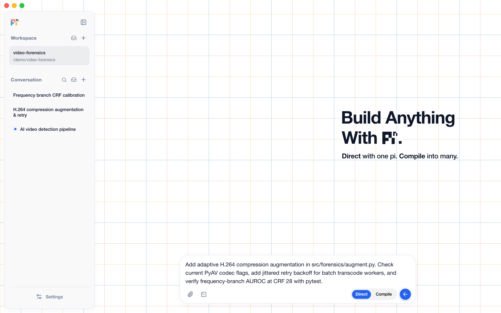
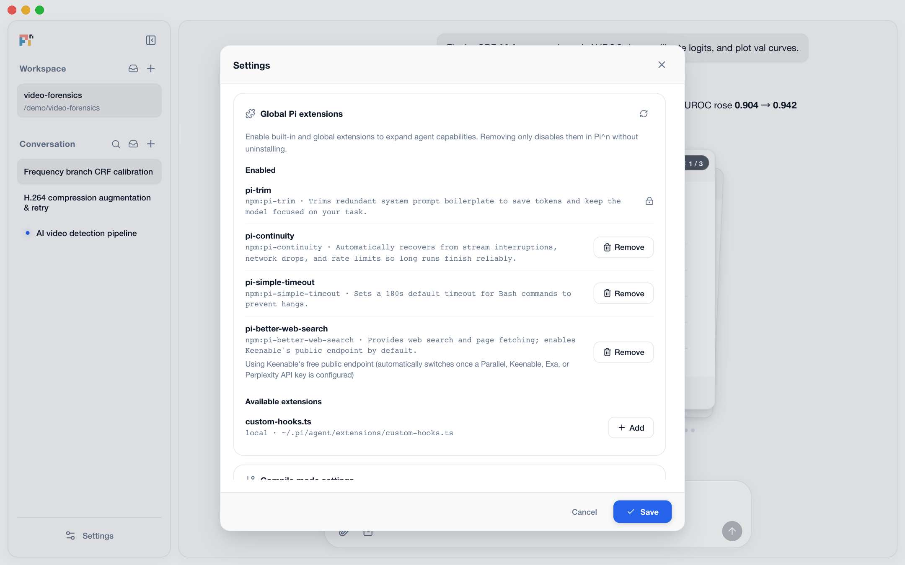
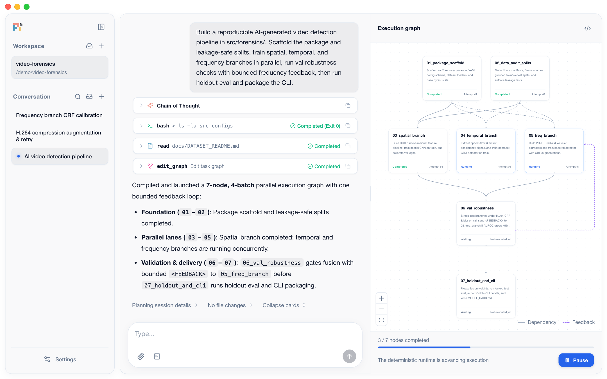

<p align="center">
  
</p>

<h1 align="center">Pi<sup>n</sup></h1>

<p align="center">
  <strong>Direct with one pi. Compile into many.</strong><br>
  A local-first desktop &amp; browser workbench built on <a href="https://github.com/earendil-works/pi">Pi</a>.<br>
  Fast, uncluttered single-agent engineering by default—compiled into deterministic multi-agent execution graphs when work scales out.
</p>

<p align="center">
  <a href="https://github.com/zhexusun10/pi-n/actions/workflows/planner-source.yml"></a>
  <a href="LICENSE"></a>
  <a href="https://www.rust-lang.org/"></a>
  <a href="https://github.com/earendil-works/pi"></a>
</p>

<p align="center">
  <a href="#the-workbench">Workbench</a> ·
  <a href="#four-bundled-plugins">Bundled Plugins</a> ·
  <a href="#compile-mode-deterministic-multi-agent-execution">Compile Mode</a> ·
  <a href="#quick-start">Quick Start</a> ·
  <a href="docs/user-guide.md">User Guide</a> ·
  <a href="README.zh-CN.md">简体中文</a>
</p>

<p align="center">
  
  <br><sub>Local-first workbench for macOS, Windows, and Linux. Start in <strong>Direct</strong> mode with one upgraded Pi agent, or switch to <strong>Compile</strong> to orchestrate parallel execution graphs.</sub>
</p>

---

## Why Pi<sup>n</sup>

Most AI coding tools force a bad tradeoff: wire up plugins, diffs, auth, and recovery yourself in a bare CLI, or adopt a heavy multi-agent framework that slows down everyday work.

**Pi<sup>n</sup> makes single-agent Pi effortless out of the box, then scales cleanly to `n` parallel agents only when the task calls for it.**

- **Everyday Upgraded Pi (`Direct`)** — Native desktop app (or browser build) bundling the pinned Pi `1.6.1` runtime, Rust backend, Node.js `22.19.0`, and on-demand portable Git. Keeps full Pi compatibility—OAuth/API-key auth, `~/.pi/agent/models.json`, slash commands, MCP, skills, and extensions—in a calm visual workspace.
- **Four Plugins Tuned Together** — **`pi-trim`**, **`pi-continuity`**, **`pi-simple-timeout`**, and **`pi-better-web-search`** ship pre-enabled so prompt bloat, dropped streams, hung commands, and missing web context are solved from your first prompt.
- **Compiled Multi-Agent Graphs (`Compile`)** — When work splits into independent modules or pipelines, Pi<sup>n</sup> compiles your goal into an inspectable execution graph driven by a deterministic Rust runtime and Git workspace handoffs—eliminating conversational "multi-agent telephone."

---

## The Workbench

Built for all-day engineering, Pi<sup>n</sup> lets **detailed execution inspection** and **calm minimalist reading** coexist in the same workspace—flipping between them in one click.

### Detailed Inspection & Minimalist Reading

<p align="center">
  
  <br><sub><strong>Detailed view + inline diffs:</strong> Inspect Chain of Thought, tool calls with live exit codes, automatic <strong>Compacted</strong> context cards (<code>118.4k → 16.2k tokens</code>), and syntax-highlighted diffs in the <strong>File changes</strong> drawer.</sub>
</p>

<p align="center">
  
  <br><sub><strong>Minimalist view (one click via <code>Collapse cards</code>):</strong> Multi-step reasoning and tool calls fold into one quiet line while plots stack into a swipeable card deck. Expand any summary line locally or click <code>Expand cards</code> to return.</sub>
</p>

- **Structured Transcripts & Inline Diffs** — Inspect collapsible Chain of Thought, tool cards with status badges and exit codes, **Compacted** cards (showing token savings, billing, and retained files), and non-error cache/reasoning notices. Open **File changes** in Direct or Compile mode for per-file `+/-` stats, inline syntax-highlighted diffs, and one-click system-editor launch.
- **Zero-Noise Reading Without Lock-In** — `Collapse cards` folds consecutive reasoning, file edits, shell runs, and web searches into a single semantic summary line remembered across conversations—while every group stays expandable on demand.
- **Interactive Image Decks & HD Previews** — When an agent outputs 3+ workspace plots or screenshots, Pi<sup>n</sup> stacks them into a swipeable, keyboard-navigable deck (`1 / 3`) with full-resolution lightbox previews and right-click copy, save, or open-in-new-window actions.
- **Mid-Flight Steering & Search** — Edit earlier messages to branch history, press **`Option+S` / `Alt+S`** to interrupt a running tool and steer immediately, **`Option+Q` / `Alt+Q`** to recall unread queued messages back into the composer, and **`⌘G` / `Ctrl+G`** to search conversations across the active workspace.

### Docked Terminal & Pi Slash Commands

<p align="center">
  
  <br><sub>Docked native PTY terminal (<code>xterm.js</code>) paired with the interactive <code>/</code> command palette (filtered to <code>/c</code>) over a clean collapsed-card transcript.</sub>
</p>

- **Docked Workspace Terminal** — Open a real shell (`xterm.js` PTY) in your project directory (or home directory if unbound) right from the composer. Resize, maximize, or minimize while keeping dev servers and test watchers alive.
- **Interactive Slash Commands (`/`)** — Switch `/model` or `/thinking` mid-conversation, curate global model pickers with `/scoped-models`, run `/compact`, `/session`, `/copy`, or `/name`, adjust shell timeouts via `/timeout`, inspect `/pi-trim`, manage `/mcp` servers, and invoke `/skill:...` inline.
- **Desktop Craft** — Choose from three home canvases (**Tri-color grid**, **Dot pattern**, or **Animated paths**), switch between **English** and **简体中文**, get background completion alerts (with optional sound), enable **Launch at login**, and stay current with signed in-app updates.

---

## Four Bundled Plugins

Pi<sup>n</sup> ships four purpose-built Pi extensions—pre-enabled by default and managed visually under **Settings → Global Pi extensions**:

<p align="center">
  
  <br><sub>All four bundled plugins are active out of the box, while external extensions discovered from <code>~/.pi/agent</code> appear as opt-in under <strong>Available extensions</strong>.</sub>
</p>

| Plugin | Default | Focus | What it solves |
| --- | --- | --- | --- |
| **[`pi-trim`](https://github.com/zhexusun10/pi-trim)** | Always on | **Prompt hygiene** | *"Less Pi in Pi."* Runs in aggressive mode to strip Pi's self-referential boilerplate and redundant tool-list text (cutting Pi 1.5.0 default system text by **70.4%**) while keeping tool schemas, `<rules>`, and your instructions intact. |
| **[`pi-continuity`](https://github.com/zhexusun10/pi-continuity)** | On by default | **Turn resilience** | Recovers output-cap truncations, dropped streams, retry cooldowns, provider quota polling, empty replies, and dangling tool tails cleanly via Pi's public session boundaries (`context_edit` + `continue: true`)—with no synthetic `"Continue"` prompts. |
| **[`pi-simple-timeout`](https://github.com/zhexusun10/pi-timeout)** | On by default | **Shell safety** | Enforces a configurable default timeout (**180s**, live-adjustable via `/timeout`) on Pi's `bash` tool and refreshes its schema live so stalled commands never hang a run. |
| **[`pi-better-web-search`](https://github.com/zhexusun10/pi-better-web-search)** | On by default | **Web memory** | Provides one unified `web_search` tool across **Parallel, Keenable, Exa, Perplexity, and DeepSeek**, with URL fetching and cross-provider fallback. Ships with **Keenable's free public endpoint** enabled and switches automatically once you add a private API key. |

> **Full Pi ecosystem compatibility:** Discovers external `~/.pi/agent` extensions as opt-in items in Settings, supports Pi's built-in **MCP** client (configure in `mcp.json` or `.pi/mcp.json`, manage via `/mcp`), loads workspace and global **Skills** (`/skill:...`), and stays in sync with `~/.pi/agent/models.json`.

---

## Compile Mode: Deterministic Multi-Agent Execution

Most multi-agent frameworks trap execution inside a fragile chat loop where a "Supervisor LLM" summarizes instructions, chats with sub-agents, and interprets replies. Every handoff burns tokens and degrades technical constraints—classic **multi-agent telephone**.

**Pi<sup>n</sup> compiles the workflow out of the conversation.** Switch the composer from **Direct** to **Compile** whenever a goal splits cleanly into parallel modules, modalities, or implementation-and-verification streams.

<p align="center">
  
  <br><sub>A live 7-node, 4-batch execution graph: completed foundation nodes (<code>01–02</code>, <code>03</code>), concurrent branches (<code>04–05</code>), downstream validation &amp; delivery (<code>06–07</code>), and a bounded <strong>Feedback</strong> edge driven by the deterministic Rust runtime.</sub>
</p>

```text
Coding goal
  │
  ├── Direct (default) ──→ Single Pi Agent (+ 4 bundled plugins) ──→ Your project
  │
  └── Compile (or Auto)
          │
          ▼
       Planner ──→ Execution Graph ──→ Rust Compiler ──→ Approval (Auto or Manual)
                                                               │
                                                               ▼
                                                   Deterministic Rust Runtime
                                                      ├── Pi Agent A ──┐
                                                      ├── Pi Agent B ──┼──→ Git Workspace Inheritance
                                                      └── Pi Agent C ──┘            │
                                                                                    ▼
                                                                            Downstream Agent(s)
                                                                                    │
                                                                                    ▼
                                                                           Publish to Project
                                                                                    │
                                                                                    ▼
                                                                       Post-task Planner Review (Loop)
```

1. **Code Over Chat** — Nodes never chat with each other. Downstream agents inherit verifiable **Git commit history and full workspace state** (including `.gitignore` files), starting with exact code and a clean context window.
2. **No Supervisor in the Loop** — The Planner compiles the graph once, then steps out of scheduling. Dependency resolution, bounded concurrency (2–40 workers), retries, invalidation, and publication are deterministic Rust state transitions.
3. **Adaptive Workspace Isolation** — At idle boundaries, small dispatches (≤3 nodes) execute directly in your project for speed. With isolation enabled, larger parallel waves run in private workspaces (macOS Seatbelt / Linux `bubblewrap`) and publish atomically once the batch succeeds.
4. **Autonomous Loops & Bounded Feedback** — **Auto Approve** and **Post-task Planner review** are on by default so the Planner inspects delivered changes and drives follow-up work automatically. Turn on **Enable Feedback** to wire review nodes back to upstream nodes with explicit retry budgets.
5. **No Hardcoded Role Theater** — Every node runs a full-capability Pi coding agent whose specialization comes solely from its objective and inherited repository state.

### Direct vs. Compile

| | Direct (Default) | Compile |
| --- | --- | --- |
| **Best for** | Everyday coding, linear or tightly coupled work | Independent parallel streams (frontend + backend, impl + tests, ML branches) |
| **Agents** | Single upgraded Pi agent (+ 4 bundled plugins) | Multi-node execution graph (DAG + optional bounded feedback) |
| **Planning & approval** | Immediate execution | Compiled graph; Auto Approve & Post-task Planner review on by default |
| **Workspace** | Direct in your project | Adaptive: shared source for ≤3 dispatched nodes; isolated workspaces for >3 |
| **Scheduling** | Sequential | Dependency-aware, bounded parallelism (2–40 workers) in Rust |

> **Tip:** Want automatic routing? Turn off **Hide Auto mode** in **Settings → UI settings** to let the Partitioner choose between Direct and Compile. Enable bounded rework edges under **Settings → Compile mode settings → Enable Feedback**.

---

## Quick Start

### 1. Desktop App (Recommended — macOS & Windows)

Download the latest installer from [GitHub Releases](https://github.com/zhexusun10/pi-n/releases/latest) and verify its SHA-256 against `SHA256SUMS.txt`:

- **macOS (Apple Silicon):** `Pi-n_<version>_aarch64.dmg`
- **macOS (Intel):** `Pi-n_<version>_x64.dmg`
- **Windows (x64):** `Pi-n_<version>_x64-setup.exe` (per-user NSIS installer)

No separate Node.js, npm, Rust, or Git installation required—the desktop bundle includes the Rust backend, pinned Pi runtime, all four plugins, private Node.js `22.19.0`, and automatic SHA-256-verified portable Git download on first launch if host Git is absent.

<details>
<summary>Data directory, legacy migration &amp; in-app updates</summary>

- **Data storage:** Runtime state lives in your OS app-data directory (`~/Library/Application Support/io.github.zhexusun10.pi-n/data` on macOS; `%APPDATA%\io.github.zhexusun10.pi-n\data` on Windows), while provider logins remain shared in `~/.pi-n/pi-agent`.
- **Automatic migration:** On first launch, any existing `.pi-n` store (or `PI_N_LEGACY_DATA_DIR`) is copied atomically under an exclusive lock, leaving the original folder untouched.
- **In-app updates:** Signed releases update directly from **Settings → Software Update** (macOS swaps the bundle in place and relaunches; Windows hands off to the signed NSIS installer). See the [updater capability matrix](docs/development/desktop-releases.md#updater--install-capability-matrix).

</details>

### 2. Prebuilt CLI / Browser Archive (macOS, Linux & Windows)

Download `pi-n-*.tar.gz` or `pi-n-windows-x64.zip` from [GitHub Releases](https://github.com/zhexusun10/pi-n/releases/latest), verify against `SHA256SUMS.txt`, extract, and run `./start.sh` (macOS/Linux) or `start.bat` (Windows). *(Requires Node.js 22.19+ and Git on `PATH`.)*

### 3. Run or Build from Source

```sh
git clone --recurse-submodules https://github.com/zhexusun10/pi-n.git
cd pi-n
npm run dev
```

`npm run dev` verifies prerequisites, initializes the `pi/` submodule, installs locked dependencies, and builds the Rust backend (for an existing clone, run `git submodule update --init --recursive` first; for manual setup, run `npm ci --ignore-scripts && npm run pi:setup`).

- **Browser workbench:** Open <http://127.0.0.1:1420> during `npm run dev`, or run `npm run build && npm start` and open <http://127.0.0.1:1421>.
- **Desktop dev (Tauri v2):** `npm run desktop:dev`
- **Build installers:** `npm run desktop:build` (supports `--target macos-arm64`, `macos-x64`, or `windows-x64` on the matching OS).

### First Run

1. **Select a workspace & provider** — Open **Settings** to bind a project folder, sign in to your provider (OAuth browser/device flow, API key, or `npm run pi`), and pick your default `provider/model`.
2. **Start in Direct mode** — All four bundled plugins are active immediately. Flip between detailed and minimalist views anytime, open **File changes** for inline diffs, or pop open the docked terminal.
3. **Scale to Compile mode** — Switch the composer to **Compile** for multi-stream work, steer any active agent with **`Option+S` / `Alt+S`**, and review published changes right in your project.

<details>
<summary>System requirements &amp; platform notes</summary>

- **Desktop installers:** Network access and model provider auth only.
- **Archives &amp; source builds:** Node.js 22.19+, Git, and npm; source builds also require stable Rust and native toolchains (macOS Xcode Command Line Tools; Windows MSVC Build Tools).
- **Workspace size &amp; isolation:** Direct mode and unisolated Compile runs have no workspace size limit; isolated Compile runs enforce a 15 GB guard (movable via subfolder or by disabling *Isolate parallel node workspaces*). macOS uses Seatbelt for private workspaces and keeps the system awake while running (`PI_N_KEEP_AWAKE=0` to disable); Linux requires `bubblewrap` with unprivileged namespaces; Windows workspaces are not filesystem sandboxes.

</details>

---

## Documentation

| Guide | What it covers |
| --- | --- |
| **[User Guide](docs/user-guide.md)** | Everyday workflow, steering controls, slash commands, workspace isolation, and recovery |
| **[Desktop Releases & Secrets](docs/development/desktop-releases.md)** | Tauri v2 builds, installers, updater signing keys, macOS notarization, and release CI |
| **[Architecture Contracts](docs/architecture/overview.md)** | System boundaries, compiler rules, Rust runtime, and Git workspace handoffs |
| **[Benchmarks](docs/benchmarks/harbor.md)** | Harbor evaluation harness and benchmark methodology |
| **[Contributing](CONTRIBUTING.md)** & **[Testing](docs/development/testing.md)** | Development setup, ownership boundaries, and targeted test suites |
| **[Docs Index](docs/index.md)** & **[Security](SECURITY.md)** | Full documentation map, agent rules ([AGENTS.md](AGENTS.md)), and vulnerability reporting |

## License

Original Pi<sup>n</sup> code is licensed under the [MIT License](LICENSE), copyright © 2026 Sun Zhe-xu. The upstream `pi/` submodule is governed by its own [MIT license](pi/LICENSE). Bundled plugins and third-party dependencies retain their respective licenses.
