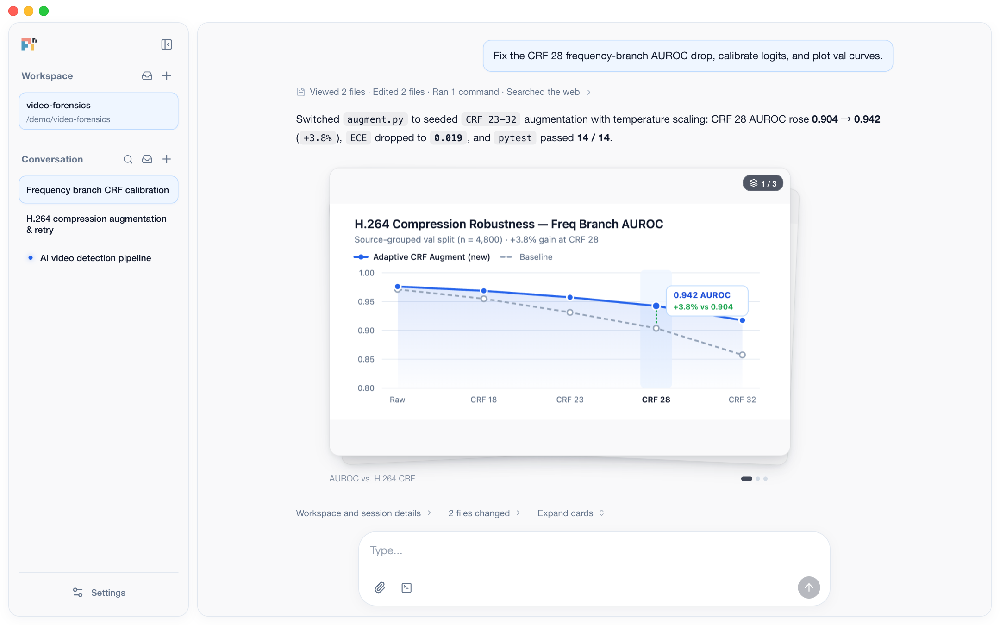

<p align="center">
  
</p>

<h1 align="center">Pi<sup>n</sup></h1>

<p align="center">
  <strong>Direct with one pi. Compile into many.</strong><br>
  An out-of-the-box, upgraded <a href="https://github.com/earendil-works/pi">Pi</a> coding workbench—pairing a serene minimalist UI, inline diffs, docked terminal, and four pre-enabled plugins for everyday single-agent engineering with a compiled, deterministic Rust multi-agent runtime when work scales out.
</p>

<p align="center">
  <sub>Local-first desktop & browser workbench for macOS, Windows, and Linux</sub>
</p>

<p align="center">
  <a href="#workbench--ui-modes">Workbench & UI</a> ·
  <a href="#four-bundled-plugins-enabled-out-of-the-box">4 Bundled Plugins</a> ·
  <a href="#compile-mode-deterministic-multi-agent-execution">Compile Mode</a> ·
  <a href="#quick-start">Quick Start</a> ·
  <a href="docs/user-guide.md">User Guide</a> ·
  <a href="README.zh-CN.md">简体中文</a>
</p>

<p align="center">
  <a href="https://github.com/zhexusun10/pi-n/actions/workflows/planner-source.yml"></a>
  <a href="LICENSE"></a>
  <a href="https://www.rust-lang.org/"></a>
  <a href="https://github.com/earendil-works/pi"></a>
</p>

<p align="center">
  
  <br><sub>Pi^n Workbench: Start in <strong>Direct</strong> mode with an upgraded single Pi agent on a calm, local-first canvas, or switch to <strong>Compile</strong> to orchestrate parallel execution graphs.</sub>
</p>

---

## Why Pi<sup>n</sup>

Most AI coding tools force a bad tradeoff: stay in a bare CLI where you hand-wire plugins, diff review, auth, and recovery yourself—or adopt a heavy multi-agent framework that slows down everyday coding.

**Pi<sup>n</sup> makes single-agent Pi extraordinary out of the box, then scales cleanly to `n` parallel agents only when the task calls for it:**

- **Everyday Upgraded Pi (`Direct` Mode)** — One native desktop app (or browser archive) bundling the pinned Pi runtime, Rust backend, Node.js `22.19.0`, and on-demand portable Git. Keep full Pi compatibility—OAuth/API-key auth, `~/.pi/agent/models.json`, slash commands, MCP, skills, and global extensions—inside a focused visual cockpit.
- **Four Purpose-Built Plugins, Enabled by Default** — Shipped and tuned together so each fixes a real failure mode of coding agents: prompt bloat (**`pi-trim`**), dropped streams and output caps (**`pi-continuity`**), hung shell commands (**`pi-simple-timeout`**), and missing web ground truth (**`pi-better-web-search`**).
- **Compiled Multi-Agent Execution (`Compile` Mode)** — When work splits into independent modules or pipelines, Pi<sup>n</sup> compiles your goal into an inspectable execution graph driven by a deterministic Rust runtime and Git workspace inheritance—eliminating conversational "multi-agent telephone."

---

## Workbench & UI Modes

Pi<sup>n</sup> is built as an engineering workbench you can live in all day—minimalist when you want focus, deep and inspectable the instant you need details.

### 1. Minimalist Collapsed-Card Mode & Inline Media

Click **`Collapse cards`** in the footer bar above the composer to fold noisy thinking blocks, tool calls, and retries into whisper-quiet single-line activity summaries—remembered globally across all conversations:

<p align="center">
  
  <br><sub>Minimalist mode (<code>Collapse cards</code> active): Multi-step reasoning and tool calls collapse into one clean line (<code>Viewed 2 files · Edited 2 files · Ran 1 command · Searched the web</code>) while plots and screenshots group into a swipeable card stack. Click any summary line to inspect its cards, or click <code>Expand cards</code> to switch back.</sub>
</p>

- **Zero-Noise Reading Flow** — Contiguous reasoning, file reads/edits, shell runs, and web searches collapse into one semantic `ActivitySummaryRow`. Click any row to expand only that group on demand without leaving minimalist mode.
- **Interactive Image Decks (`MarkdownImageStack`)** — When an agent outputs 3+ workspace plots, screenshots, or web images, Pi<sup>n</sup> automatically stacks them into a swipeable, keyboard-navigable deck (`1 / 3`) with click-to-zoom lightbox previews.

### 2. Full Card Inspection & Inline Diffs

Switch back to expanded cards anytime (`Expand cards` / `Collapse cards`) and toggle the right-hand **File changes** pane for side-by-side code review:

<p align="center">
  
  <br><sub>Detailed view + inline diffs: Inspect <strong>Chain of Thought</strong>, tool calls with live exit codes, automatic <strong>Compacted</strong> context cards (<code>118.4k → 16.2k tokens</code>), and expandable syntax-highlighted diffs in the <strong>File changes</strong> drawer.</sub>
</p>

- **Structured Transcript Cards** — Inspect collapsible **Chain of Thought**, **Tool Call** cards with status badges and exit codes, and **Compacted** cards displaying token savings and retained file context.
- **Inline Diff Inspector** — Open **File changes** in either Direct or Compile mode to view per-file `+/-` counts, click any row to expand its syntax-highlighted diff inline, or launch the file in your system editor.
- **Mid-Flight Steering & Fast Navigation** — Edit earlier messages to branch history, press **`Alt+S`** to interrupt a running tool and steer immediately, **`Alt+Q`** to withdraw unread queued messages back into the composer, and **`⌘G` / `Ctrl+G`** to search conversations across the active workspace.

### 3. Docked Workspace Terminal & Pi Slash Commands

All the speed of the Pi CLI without leaving your visual workbench:

<p align="center">
  
  <br><sub>Docked native PTY terminal (<code>xterm.js</code>) paired with the interactive <code>/</code> command palette (filtered here to <code>/c</code>: <code>/copy</code>, <code>/compact</code>, <code>/mcp</code>, and <code>/scoped-models</code>) over a clean collapsed-card transcript.</sub>
</p>

- **Docked Workspace Terminal** — Click the terminal button beside attachments to open a real shell (`xterm.js` PTY) in your project directory. Resize, maximize, or minimize while keeping dev servers and watchers alive.
- **Interactive Slash Commands (`/`)** — Switch `/model` or `/thinking` mid-conversation, filter global model pickers with `/scoped-models`, run `/compact`, `/session`, `/copy`, or `/name`, adjust bash timeouts via `/timeout`, inspect `/pi-trim`, manage `/mcp` servers, and invoke `/skill:...` directly in the composer.
- **Desktop Craft** — Choose your home canvas (**Tri-color grid** default, **Dot pattern**, or **Animated paths**), switch between **English** and **简体中文**, get background completion notifications (with optional sound), enable **Launch at login**, and stay current with cryptographically verified in-app updates.

---

## Four Bundled Plugins, Enabled Out of the Box

Pi<sup>n</sup> ships four dedicated Pi extensions tuned to work together—all enabled by default and managed visually under **Settings → Global Pi extensions**:

<p align="center">
  
  <br><sub>All four bundled plugins are active out of the box alongside built-in <code>mcp</code> and global <code>~/.pi/agent</code> extensions—manage them visually without hand-editing config files.</sub>
</p>

| Plugin | Default | Role | What it solves |
| --- | --- | --- | --- |
| **[`pi-trim`](https://github.com/zhexusun10/pi-trim)** | Always on | **Prompt hygiene** | *"Less Pi in Pi."* Runs in aggressive mode by default—stripping Pi's self-referential boilerplate, `<docs>` pointers, `PI_*` env-var rule, and redundant `<tools>` text list (already declared in API tool schemas) to cut Pi 1.5.0 default system text by **70.4%** while keeping tool schemas, `<rules>`, and your instructions intact. |
| **[`pi-continuity`](https://github.com/zhexusun10/pi-continuity)** | On by default | **Turn resilience** | Automatically recovers output-cap truncations (`stopReason: "length"`), dropped streams, advertised retry cooldowns, provider usage-limit polling, empty/reasoning-only replies, and dangling tool-call tails via Pi's public session boundaries (`context_edit` + `continue: true`)—with zero synthetic `"Continue"` prompts. |
| **[`pi-simple-timeout`](https://github.com/zhexusun10/pi-timeout)** | On by default | **Shell safety** | Adds a configurable default timeout (**180s** by default, live-adjustable via `/timeout`) to Pi's built-in `bash` tool and updates its schema live so stalled commands never hang an autonomous run. |
| **[`pi-better-web-search`](https://github.com/zhexusun10/pi-better-web-search)** | On by default | **Web working memory** | Adds one clean `web_search` tool supporting **Parallel, Keenable, Exa, Perplexity, and DeepSeek** APIs, URL fetching, raw results, and automatic cross-provider fallback. Ships with **Keenable's free public endpoint** enabled by default and automatically switches to your private API key once you configure Parallel, Keenable, Exa, or Perplexity. |

> **Full Pi ecosystem compatibility:** Pi<sup>n</sup> also discovers your global extensions in `~/.pi/agent`, integrates built-in **MCP** (`/mcp`), loads workspace and global **Skills** (`/skill:...`), and stays in sync with your local `~/.pi/agent/models.json`.

---

## Compile Mode: Deterministic Multi-Agent Execution

When a goal splits cleanly into independent modules, modalities, or implementation-and-verification streams, switch the composer from **Direct** to **Compile**.

Most multi-agent frameworks trap work inside a fragile chat loop: a "Supervisor LLM" summarizes instructions, chats with sub-agents, interprets replies, and decides what runs next. Every handoff burns tokens and degrades technical constraints—classic **multi-agent telephone**.

**Pi<sup>n</sup> compiles the workflow out of the conversation.**

<p align="center">
  
  <br><sub>Compile mode in action: A 7-node, 4-batch execution graph with completed foundation nodes (<code>01–02</code>, <code>03</code>), live parallel branches (<code>04–05</code>), downstream validation & delivery (<code>06–07</code>), and a bounded <strong>Feedback</strong> edge driven by the deterministic Rust runtime.</sub>
</p>

```text
Coding goal
  │
  ├── Direct (default) ──→ Single Pi Agent (+ 4 bundled plugins) ──→ Your project
  │
  └── Compile (or Auto)
          │
          ▼
       Planner ──→ Execution Graph ──→ Rust Compiler ──→ Approval (Auto or Manual)
                                                               │
                                                               ▼
                                                   Deterministic Rust Runtime
                                                      ├── Pi Agent A ──┐
                                                      ├── Pi Agent B ──┼──→ Git Workspace Inheritance
                                                      └── Pi Agent C ──┘            │
                                                                                    ▼
                                                                            Downstream Agent(s)
                                                                                    │
                                                                                    ▼
                                                                           Publish to Project
                                                                                    │
                                                                                    ▼
                                                                       Post-task Planner Review (Loop)
```

1. **Code Over Chat (Zero "Lost in Translation")** — Nodes never chat with each other. Downstream agents inherit verifiable **Git commit history and complete workspace state** (including `.gitignore` files), starting each task with exact code and a clean context window.
2. **No Supervisor in the Execution Loop** — The Planner compiles the task graph once, then steps out of scheduling. Dependency resolution, bounded concurrency (2–40 workers), retries, invalidation, and publication are deterministic Rust state transitions.
3. **Adaptive Workspace Isolation** — At idle boundaries, small dispatches (≤3 nodes) work directly in your source tree for instant speed. With isolation enabled, larger parallel waves execute in private workspaces (macOS Seatbelt / Linux `bubblewrap`) and publish atomically once the batch succeeds.
4. **Autonomous Loop Engineering & Bounded Feedback** — With **Auto Approve** and **Post-task Planner review** enabled by default, the Planner inspects delivered changes and drives follow-up work or final verification automatically. Toggle **Enable Feedback** to connect review nodes back to upstream nodes with explicit retry budgets.
5. **No Hardcoded Role Theater** — Every node runs a full-capability Pi coding agent whose specialization comes purely from its task objective and inherited repository state.

### Direct vs. Compile at a Glance

| | Direct (Default) | Compile |
| --- | --- | --- |
| **Best for** | Everyday coding, linear or tightly coupled work | Independent parallel streams (frontend + backend, impl + tests, ML branches) |
| **Agents** | Single upgraded Pi agent (+ 4 bundled plugins) | Multi-node execution graph (DAG + optional bounded feedback) |
| **Planning & Approval** | Immediate execution | Compiled graph; Auto Approve & Post-task Planner review on by default |
| **Workspace** | Direct in your project | Adaptive: shared source for ≤3 dispatched nodes; private isolated workspaces for >3 |
| **Scheduling** | Sequential | Dependency-aware, bounded parallelism (2–40 workers) in Rust |

> **Tip:** Want automatic routing? Turn off **Hide Auto mode** in **Settings → UI settings** to let the Partitioner choose between **Direct** and **Compile**. Turn on **Enable Feedback** in **Settings → Compile mode settings** to unlock bounded rework edges. See the [User Guide](docs/user-guide.md) for workspace and delivery details.

---

## Quick Start

### Option 1: Desktop App (Recommended — macOS & Windows)

Download the latest native installer from [GitHub Releases](https://github.com/zhexusun10/pi-n/releases/latest) and verify its checksum against `SHA256SUMS.txt`:

- **macOS (Apple Silicon):** `Pi-n_<version>_aarch64.dmg` (drag `Pi^n.app` to Applications)
- **macOS (Intel):** `Pi-n_<version>_x64.dmg` (drag `Pi^n.app` to Applications)
- **Windows (x64):** `Pi-n_<version>_x64-setup.exe` (per-user NSIS installer)

The desktop app bundles the compiled Rust backend, pinned Pi runtime, all four bundled plugins, and a private Node.js `22.19.0` runtime—no separate Node.js, npm, Rust, or manual Git setup required (if no working host Git is found on first launch, Pi<sup>n</sup> automatically downloads and SHA-256-verifies a portable copy).

- **Data & seamless migration:** Desktop runtime data lives in your OS application data directory (`~/Library/Application Support/io.github.zhexusun10.pi-n/data` on macOS; `%APPDATA%\io.github.zhexusun10.pi-n\data` on Windows), while provider logins stay shared in `~/.pi-n/pi-agent`. On first launch, any existing `.pi-n` store (or `PI_N_LEGACY_DATA_DIR`) is copied atomically under exclusive lock while leaving the legacy folder intact.
- **In-app updates:** Signed releases support cryptographically verified updates under **Settings → Software Update** (macOS swaps the bundle in place and relaunches; Windows hands off to the signed NSIS installer). See the [capability matrix](docs/development/desktop-releases.md#updater--install-capability-matrix).

### Option 2: Prebuilt CLI / Browser Archive (macOS, Linux & Windows)

Download the latest relocatable [release archive](https://github.com/zhexusun10/pi-n/releases/latest) (`pi-n-*.tar.gz` or `pi-n-windows-x64.zip`), verify against `SHA256SUMS.txt`, extract, and launch:

- **Windows:** `start.bat`
- **macOS / Linux:** `./start.sh`

*(Requires Node.js 22.19+ and Git on `PATH`.)*

### Option 3: Run or Build from Source

```sh
git clone --recurse-submodules https://github.com/zhexusun10/pi-n.git
cd pi-n
npm run dev
```

`npm run dev` verifies prerequisites, initializes the pinned `pi/` submodule, installs locked dependencies (including the four bundled plugins), and builds the Rust backend (for manual setup, run `npm ci --ignore-scripts` then `npm run pi:setup`). For an existing clone, run `git submodule update --init --recursive` first.

- **Browser mode:** Open **<http://127.0.0.1:1420>** during `npm run dev`, or run `npm run build && npm start` and open <http://127.0.0.1:1421>.
- **Desktop dev mode (Tauri v2):** Run `npm run desktop:dev`.
- **Build desktop installers:** Run `npm run desktop:build` (supports `--target macos-arm64`, `macos-x64`, or `windows-x64` on the matching OS). See [Desktop Releases & Secrets](docs/development/desktop-releases.md).

### First Run

1. **Bind a workspace & provider** — Open **Settings** to pick a local project folder, authenticate your model provider (OAuth browser/device login, API key, or `npm run pi`), and choose your default `provider/model`.
2. **Work in Direct mode** — All four bundled plugins (including `pi-better-web-search`) are active immediately. Toggle **Collapse cards** for minimalist reading, open **File changes** for inline diffs, or launch the docked terminal.
3. **Scale to Compile mode** — Switch the composer to **Compile** for multi-stream goals, steer any running agent mid-flight with **`Alt+S`**, and review changes directly in your workspace.

**System requirements & platform notes:**
- **Desktop installers:** Network access and model provider auth (Node.js `22.19.0`, pinned Pi, and all 4 plugins are bundled; portable Git auto-downloads if absent).
- **Archives & source builds:** Node.js 22.19+, Git, npm; source builds also require stable Rust and native build tools (macOS Xcode Command Line Tools; Windows MSVC Build Tools).
- **Isolation & power:** macOS uses Seatbelt for private Compile workspaces and keeps the system awake while the backend runs (`PI_N_KEEP_AWAKE=0` to disable); Linux private workspaces require `bubblewrap` with unprivileged user/mount/PID namespaces; Windows workspaces are not filesystem sandboxes.

---

## Documentation & Resources

| Guide | What it covers |
| --- | --- |
| **[User Guide](docs/user-guide.md)** | Everyday workflow, steering controls, slash commands, workspace isolation, data migration, and recovery |
| **[Desktop Releases & Secrets](docs/development/desktop-releases.md)** | Tauri v2 desktop builds, installers, updater signing keys, macOS signing/notarization, and CI release workflow |
| **[Architecture Contracts](docs/architecture/overview.md)** | System boundaries, compiler rules, deterministic Rust runtime, and Git workspace handoffs |
| **[Benchmarks](docs/benchmarks/harbor.md)** | Harbor evaluation harness and benchmark methodology |
| **[Contributing Guide](CONTRIBUTING.md)** & **[Testing](docs/development/testing.md)** | Development setup, ownership boundaries, and targeted test suites |
| **[Documentation Index](docs/index.md)** & **[Security Policy](SECURITY.md)** | Full documentation map, agent rules ([AGENTS.md](AGENTS.md)), and vulnerability reporting |

## License

Original Pi<sup>n</sup> code is licensed under the [MIT License](LICENSE), copyright © 2026 Sun Zhe-xu. The upstream `pi/` submodule is governed by its own [MIT license and copyright notice](pi/LICENSE). Bundled plugins and third-party dependencies retain their respective licenses.
