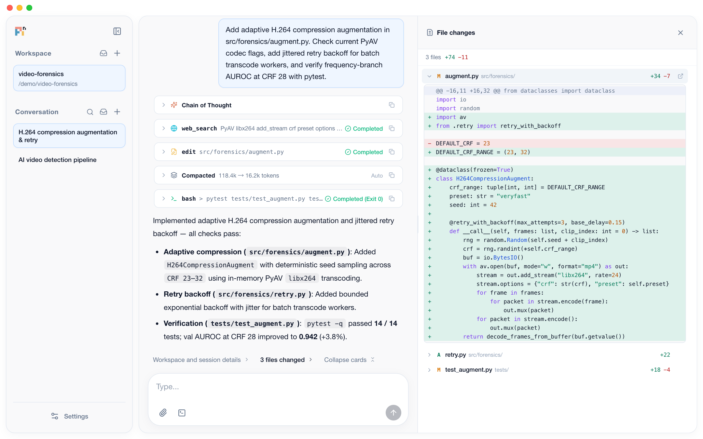
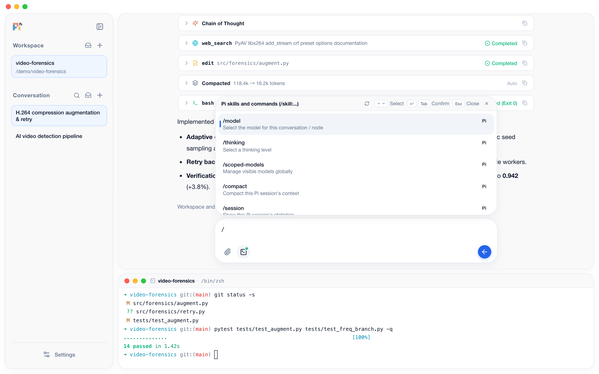

<p align="center">
  
</p>

<h1 align="center">Pi<sup>n</sup></h1>

<p align="center">
  <strong>Direct with one pi. Compile into many.</strong><br>
  An out-of-the-box, upgraded <a href="https://github.com/earendil-works/pi">Pi</a> coding workbench—paired with four purpose-built plugins for rock-solid single-agent engineering, and a compiled multi-agent execution graph powered by a deterministic Rust runtime when work scales out.
</p>

<p align="center">
  <sub>Local-first desktop & browser workbench for macOS, Windows, and Linux</sub>
</p>

<p align="center">
  <a href="#quick-start">Quick start</a> ·
  <a href="#four-purpose-built-plugins-batteries-included">4 Built-in Plugins</a> ·
  <a href="#workbench--ui-modes">UI Modes</a> ·
  <a href="#compile-mode-scale-to-pin-without-multi-agent-telephone">Multi-Agent Architecture</a> ·
  <a href="docs/user-guide.md">User guide</a> ·
  <a href="README.zh-CN.md">简体中文</a>
</p>

<p align="center">
  <a href="https://github.com/zhexusun10/pi-n/actions/workflows/planner-source.yml"></a>
  <a href="LICENSE"></a>
  <a href="https://www.rust-lang.org/"></a>
  <a href="https://github.com/earendil-works/pi"></a>
</p>

<p align="center">
  
  <br><sub>Pi^n Workbench: Start in <strong>Direct</strong> mode with a single upgraded Pi agent, or switch to <strong>Compile</strong> to turn complex goals into parallel execution graphs.</sub>
</p>

---

## Start with a Better Pi. Scale to Pi<sup>n</sup>.

Most AI coding tools force an unnecessary tradeoff: stay in a bare CLI where you hand-wire plugins, auth, diff review, and recovery yourself—or adopt a noisy multi-agent framework that slows down everyday engineering.

**Pi<sup>n</sup> starts by making single-agent Pi extraordinary out of the box—then lets it scale cleanly to `n` parallel agents when the task actually calls for it:**

- **Out-of-the-Box Upgraded Pi (`Direct` Mode)** — Install one native desktop app (or browser archive) with the pinned Pi runtime, Rust backend, Node.js, and portable Git ready to go. Keep full Pi compatibility—providers, OAuth/API-key auth, local `models.json`, slash commands, MCP servers, skills, and global extensions—wrapped in a crisp visual workbench.
- **Four Purpose-Built Bundled Plugins** — Shipped and tuned together so each solves one real failure mode of coding agents: bloated system prompts (**`pi-trim`**), dropped streams and truncated turns (**`pi-continuity`**), hung shell commands (**`pi-simple-timeout`**), and missing web ground truth (**`pi-better-web-search`**).
- **Compiled Multi-Agent Execution (`Compile` Mode)** — When a goal splits into independent workstreams, Pi<sup>n</sup> compiles your work into an inspectable execution graph driven by a deterministic Rust runtime and Git workspace inheritance—eliminating conversational "multi-agent telephone."

---

## Four Purpose-Built Plugins, Batteries Included

Pi<sup>n</sup> bundles four dedicated Pi extensions—each focused on a single job, zero prompt bloat, managed visually from **Settings → Global Pi extensions**:

<p align="center">
  
  <br><sub>All four bundled plugins plus built-in MCP and global <code>~/.pi/agent</code> extensions, toggled visually without touching config files.</sub>
</p>

| Plugin | Default | Role | What it solves |
| --- | --- | --- | --- |
| **[`pi-trim`](https://github.com/zhexusun10/pi-trim)** | Always on | **Prompt hygiene** | *"Less Pi in Pi."* Strips Pi's self-referential boilerplate, `<docs>` pointers, `PI_*` env-var rule, and redundant `<tools>` text summary (already declared in API tool schemas)—cutting Pi's default system text by **70.4%** while keeping tool schemas, `<rules>`, and your instructions intact, reducing token waste and framework bias so the model stays focused on your task. |
| **[`pi-continuity`](https://github.com/zhexusun10/pi-continuity)** | On | **Turn resilience** | Automatically recovers output-cap truncations (`stopReason: "length"`), failed/terminated streams, explicit retry cooldowns, provider usage-limit polling, empty/reasoning-only responses, and dangling tool-call tails via Pi's public session boundaries (`context_edit` + `continue: true`)—with zero synthetic "Continue" prompts. |
| **[`pi-simple-timeout`](https://github.com/zhexusun10/pi-timeout)** | On | **Shell safety** | Adds a configurable default timeout (**180s** by default, live-adjustable via `/timeout`) to Pi's built-in `bash` tool and updates its schema live so stalled processes never freeze an autonomous run. |
| **[`pi-better-web-search`](https://github.com/zhexusun10/pi-better-web-search)** | One-click opt-in | **Web working memory** | Adds one clean `web_search` tool backed by dedicated search APIs (**Parallel, Keenable, Exa, Perplexity, DeepSeek**), URL fetching, raw provider results, and automatic fallback—including a zero-config **Keenable free public endpoint** option right in Settings (automatically switching once you add a private API key). |

> **Full Pi ecosystem compatibility:** Pi<sup>n</sup> also discovers your global extensions in `~/.pi/agent`, exposes built-in **MCP** (`/mcp`), loads workspace/global **Skills** (`/skill:...`), and stays in sync with `~/.pi/agent/models.json`.

---

## Workbench & UI Modes

Pi<sup>n</sup> is designed as an engineering cockpit you can live in all day—whether you are running a fast single-agent refactor or supervising a 12-node parallel pipeline.

### 1. Direct Mode & Inline Diff Inspector

Work directly in your repository with a clean, scannable transcript and live side-by-side code review:

<p align="center">
  
  <br><sub>Direct mode: Streaming Chain of Thought, tool calls (<code>web_search</code>, <code>edit</code>, <code>bash</code>), automatic context compaction cards (<code>118.4k → 16.2k tokens</code>), and expandable syntax-highlighted inline diffs.</sub>
</p>

- **Structured Transcript Cards** — Inspect collapsible **Chain of Thought**, **Tool Call** cards with live status and exit codes, **Compacted** context cards showing token savings and retained files, and inline workspace image previews.
- **Inline File Changes & Diffs** — Toggle the right-hand **File changes** pane in either Direct or Compile mode to review `+/-` stats, expand syntax-highlighted diffs inline, or jump straight to any file in your system editor.
- **Mid-Flight Steering & Branching** — Edit earlier messages to branch history, press **`Alt+S`** to interrupt a running tool and steer immediately, or **`Alt+Q`** to withdraw unread queued messages back into the composer.

### 2. Integrated Workspace Terminal & Pi Slash Commands

All the speed of the Pi CLI—without leaving your visual workbench:

<p align="center">
  
  <br><sub>Docked native PTY workspace terminal alongside the interactive <code>/</code> command palette (<code>/model</code>, <code>/thinking</code>, <code>/scoped-models</code>, <code>/compact</code>, <code>/timeout</code>, <code>/pi-trim</code>, <code>/mcp</code>, and <code>/skill:...</code>).</sub>
</p>

- **Docked Workspace Terminal** — Click the terminal button beside attachments to open a real shell (`xterm.js` PTY) in your active workspace. Resize, maximize, or minimize without killing running dev servers or watchers.
- **Interactive Slash Commands (`/`)** — Switch `/model` or `/thinking` mid-conversation, hide clutter globally with `/scoped-models`, compact context with `/compact`, tune bash timeouts with `/timeout`, manage `/mcp` servers, invoke `/skill:...`, and run custom extension dialogs directly in the composer.
- **Thoughtful Desktop Polish** — Customize the home canvas (**Tri-color grid**, **Dot pattern** or **Animated paths**), switch between **English** and **简体中文**, get background completion notifications (with optional sound), enable **Launch at login**, and stay current with cryptographically verified in-app updates.

---

## Compile Mode: Scale to Pi<sup>n</sup> Without Multi-Agent Telephone

When a task spans independent modules, modalities, or build-and-verify streams, switch the composer from **Direct** to **Compile**.

Most multi-agent frameworks trap your work inside a fragile conversation loop: a "Supervisor LLM" summarizes instructions, chats with sub-agents, interprets their replies, and decides what to do next. At every handoff, technical constraints degrade, tokens burn, and context gets **lost in translation**.

**Pi<sup>n</sup> compiles the workflow out of the conversation.**

<p align="center">
  
  <br><sub>Compile mode: A 12-node, 6-batch demonstration plan compiled into parallel spatial, temporal, and frequency lanes, validation selection, and a bounded feedback loop (shown with manual approval enabled; not a completed run).</sub>
</p>

```text
Typical multi-agent systems (Conversational orchestration)

Goal → Supervisor LLM → Agent → Supervisor LLM → Agent → ...
             ↑ scheduling & state live inside a lossy chat loop


Pi^n Compile mode (Compiled execution graph)

Goal → Planner → Compiled Graph → Deterministic Rust Runtime
                                      ├── Pi Agent A ──┐
                                      ├── Pi Agent B ──┼──→ Pi Agent D ──→ Git Publish
                                      └── Pi Agent C ──┘
```

1. **Zero "Lost in Translation" (Code over Chat)** — Nodes never chat with each other. Downstream agents inherit verifiable **Git commit history and complete workspace state** (including `.gitignore` files), not summarized transcripts. Every agent starts with a clean context window and exact code.
2. **No Supervisor in the Execution Loop** — The Planner compiles the task graph once, then steps out of the scheduler. Dependency resolution, bounded concurrency (2–40 agents), retries, invalidation, and publication are deterministic Rust state transitions.
3. **Adaptive Workspace Isolation** — At idle boundaries, small dispatches (≤3 nodes after the worker cap) work directly in your source tree for instant speed. With isolation enabled, larger waves run in private workspaces (macOS Seatbelt / Linux `bubblewrap`) and publish atomically once the batch succeeds.
4. **Autonomous Loop Engineering & Bounded Feedback** — With **Auto Approve** and **Post-task Planner Review** enabled by default, Pi<sup>n</sup> closes the iteration loop automatically: after delivery, the Planner inspects the updated repository and compiles follow-up work or final verification until the goal is met. Turn on **Enable Feedback** in Settings to connect review nodes back to implementation nodes with explicit retry budgets.
5. **No Hardcoded Role Theater** — Forget artificial "PM / Architect / QA" personas. Every node runs a full-capability Pi coding agent whose specialization comes purely from its task objective and inherited codebase state.

---

## Right-Sized for Every Task: Direct vs. Compile

**More agents are not always better.** Pi<sup>n</sup> defaults to **Direct** so small, linear work stays instantaneous, and shifts to **Compile** whenever true parallelism pays off:

- **Frontend + Backend** changes developed concurrently
- **Implementation + Tests** built and verified in parallel workstreams
- **ML & Research Pipelines** with independent feature, training, and evaluation branches
- **Implementation + Review** with optional bounded automated rework loops

| | Direct (Default) | Compile |
| --- | --- | --- |
| **Best for** | Everyday coding, linear or tightly coupled tasks | Complex goals with independent parallel workstreams |
| **Agents** | Single upgraded Pi agent (+ 4 bundled plugins) | Multi-node execution graph (DAG + optional bounded feedback) |
| **Planning** | Immediate execution | Compiled execution graph + optional post-task Planner review loop |
| **Approval** | Immediate | Auto Approve by default; manual approval gate optional |
| **Workspace** | Direct in your project | Adaptive at idle boundaries: shared source for ≤3 dispatched nodes; private workspaces for >3 when isolation is enabled |
| **Scheduling** | Sequential | Dependency-aware, bounded parallelism (2–40 workers) in Rust |

> **Tip:** Want automatic routing? Disable *Hide Auto mode* in **Settings → UI settings** to let the Partitioner choose between **Direct** and **Compile** automatically. Toggle **Enable Feedback** in **Settings → Harness settings** to unlock bounded rework edges. See the [User Guide](docs/user-guide.md) for full workspace and delivery details.

### How it works

```text
Coding goal
    │
    ├── Direct mode (default) ──→ Single Pi Agent (+ 4 bundled plugins) ──→ Your project
    │
    └── Compile mode (or Auto)
                │
                ▼
             Planner
                │
                ▼
       Execution graph ──→ Rust Compiler ──→ Approval (Auto or Manual)
                                                    │
                                                    ▼
                                       Deterministic Rust runtime
                                           │               │
                                       Pi Agent A      Pi Agent B
                                           \               /
                                       Git workspace inheritance
                                                    │
                                                    ▼
                                               Pi Agent C
                                                    │
                                                    ▼
                                           Publish to project
                                                    │
                                                    ▼
                                      Post-task Planner review (Loop)
```

---

## Quick start

### Option 1: Desktop App (Recommended — macOS & Windows)

Download the latest native installer from [GitHub Releases](https://github.com/zhexusun10/pi-n/releases/latest) and verify its checksum against `SHA256SUMS.txt`:

- **macOS (Apple Silicon):** `Pi-n_<version>_aarch64.dmg` (drag `Pi^n.app` to Applications)
- **macOS (Intel):** `Pi-n_<version>_x64.dmg` (drag `Pi^n.app` to Applications)
- **Windows (x64):** `Pi-n_<version>_x64-setup.exe` (per-user NSIS installer)

The desktop app bundles the compiled Rust backend, pinned Pi/engine runtime, all four bundled plugins, and a private Node.js `22.19.0` runtime—no separate Node.js, npm, Rust, or manual Git installation is required (if no working host Git is found on first launch, Pi<sup>n</sup> automatically downloads and SHA-256-verifies a portable copy).

- **Data & seamless migration:** Desktop runtime data lives in your OS application data directory (`~/Library/Application Support/io.github.zhexusun10.pi-n/data` on macOS; `%APPDATA%\io.github.zhexusun10.pi-n\data` on Windows), while provider logins stay shared in `~/.pi-n/pi-agent`. On first launch, if an existing `.pi-n` store is found (or specified via `PI_N_LEGACY_DATA_DIR`), it is copied atomically under exclusive lock while leaving the legacy directory intact.
- **In-app updates:** Signed releases support cryptographically verified updates under **Settings → Software Update** (macOS swaps the app bundle in place and relaunches; Windows hands off to the signed NSIS installer). See the [capability matrix](docs/development/desktop-releases.md#updater--install-capability-matrix) for signing details.

### Option 2: Prebuilt CLI / Browser Archive (macOS, Linux & Windows)

Download the latest relocatable [release archive](https://github.com/zhexusun10/pi-n/releases/latest) (`pi-n-*.tar.gz` or `pi-n-windows-x64.zip`), verify its checksum against `SHA256SUMS.txt`, extract it, and launch:

- **Windows:** `start.bat`
- **macOS / Linux:** `./start.sh`

*(Requires Node.js 22.19+ and Git on `PATH`.)*

### Option 3: Run or Build from Source

```sh
git clone --recurse-submodules https://github.com/zhexusun10/pi-n.git
cd pi-n
npm run dev
```

`npm run dev` checks prerequisites, initializes the pinned `pi/` submodule, installs locked dependencies (including the four bundled plugins), and compiles the Rust backend (for manual step-by-step setup, run `npm ci --ignore-scripts` then `npm run pi:setup`). For an existing clone, run `git submodule update --init --recursive` first.

- **Browser mode:** Open **<http://127.0.0.1:1420>** during `npm run dev`, or run `npm run build && npm start` and open <http://127.0.0.1:1421>.
- **Desktop dev mode (Tauri v2):** Run `npm run desktop:dev`.
- **Build native desktop installers:** Run `npm run desktop:build` (supports `--target macos-arm64`, `macos-x64`, or `windows-x64` on the matching OS). See [Desktop Releases & Secrets](docs/development/desktop-releases.md) for signing and notarization workflows.

### Your First Run

1. **Connect a workspace & provider** — Open **Settings** to bind a local project folder, sign in to your model provider (OAuth browser/device login or API key, or via `npm run pi`), and pick your default `provider/model`.
2. **Optional: Enable Web Search** — In **Settings → Global Pi extensions**, turn on **`pi-better-web-search`** (works immediately with Keenable's free public endpoint, or plug in your own Parallel / Keenable / Exa / Perplexity / DeepSeek API key).
3. **Choose Direct or Compile** — Use **Direct** (default) for fast single-agent work with inline diffs and the docked terminal, or switch to **Compile** for multi-agent execution graphs.
4. **Inspect, steer, and verify** — Review live tool calls and file diffs, open the integrated terminal, pause or steer any agent mid-flight (`Alt+S`), and verify published changes directly in your workspace.

**System requirements:**
- **Desktop installers:** Network access and model provider authentication. Node.js 22.19.0, the pinned Pi runtime, and the four bundled plugins are included; portable Git is downloaded automatically on first launch if absent.
- **Archives & source builds:** Node.js 22.19+, Git, npm, plus stable Rust and native compiler/linker tools for source builds (macOS Xcode Command Line Tools; Windows MSVC Build Tools).
- **Platform notes:** macOS uses the built-in Seatbelt sandbox for private Compile workspaces and keeps the system awake while the backend runs (`PI_N_KEEP_AWAKE=0` to disable); Linux private workspaces require `bubblewrap` with unprivileged user/mount/PID namespaces enabled; Windows workspaces are not filesystem sandboxes.

---

## Documentation & Resources

| Guide | What it covers |
| --- | --- |
| **[User Guide](docs/user-guide.md)** | Everyday workflow, steering controls, slash commands, workspace isolation, data migration, and recovery |
| **[Desktop Releases & Secrets](docs/development/desktop-releases.md)** | Tauri v2 desktop builds, installers, updater signing keys, macOS signing/notarization, and CI release workflow |
| **[Architecture Contracts](docs/architecture/overview.md)** | System boundaries, compiler rules, deterministic Rust runtime, and Git workspace handoffs |
| **[Benchmarks](docs/benchmarks/harbor.md)** | Harbor evaluation harness and benchmark methodology |
| **[Contributing Guide](CONTRIBUTING.md)** & **[Testing](docs/development/testing.md)** | Development setup, ownership boundaries, and targeted test suites |
| **[Documentation Index](docs/index.md)** & **[Security Policy](SECURITY.md)** | Full documentation map, agent rules ([AGENTS.md](AGENTS.md)), and vulnerability reporting |

## License

Original Pi<sup>n</sup> code is licensed under the [MIT License](LICENSE), copyright © 2026 Sun Zhe-xu. The upstream `pi/` submodule is governed by its own [MIT license and copyright notice](pi/LICENSE). Bundled plugins and third-party dependencies retain their respective licenses.
