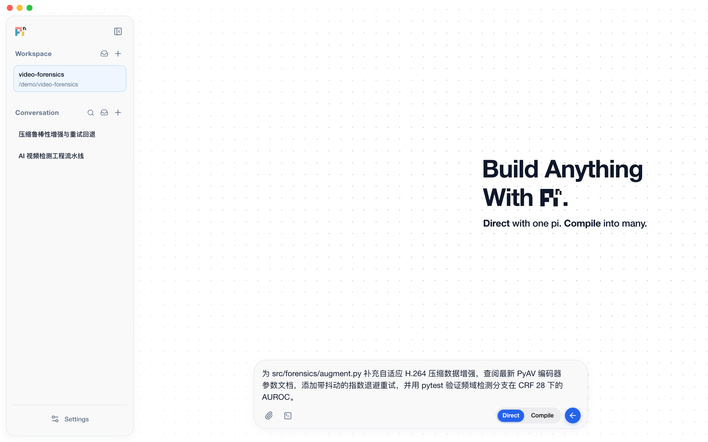
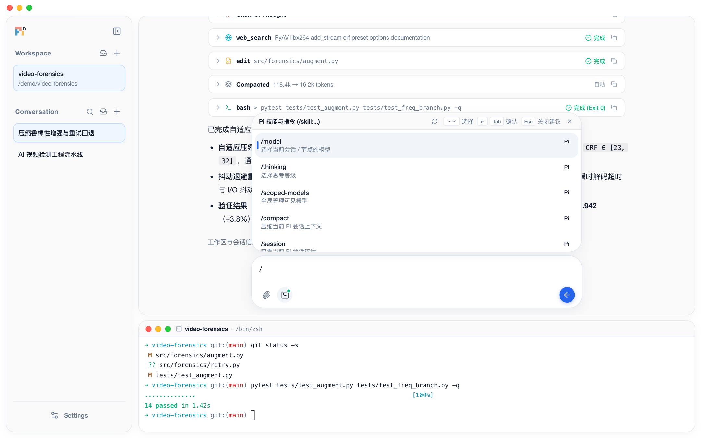

<p align="center">
  
</p>

<h1 align="center">Pi<sup>n</sup></h1>

<p align="center">
  <strong>Direct with one pi. Compile into many.</strong><br>
  开箱即用、全面进化的 <a href="https://github.com/earendil-works/pi">Pi</a> Coding Agent 工作台——内置四款各司其职的精选插件，打磨极致可靠的单 Agent 工程体验；当任务需要并行扩展时，一键切换编译式多 Agent 执行图，由确定性 Rust 运行时驱动。
</p>

<p align="center">
  <sub>面向 macOS、Windows 与 Linux 的本地优先桌面端与浏览器工作台</sub>
</p>

<p align="center">
  <a href="#快速开始">快速开始</a> ·
  <a href="#四款各司其职的内置插件开箱即强">四款内置插件</a> ·
  <a href="#工作台与多样-ui-模式">工作台与 UI 模式</a> ·
  <a href="#compile-模式从-pi-无缝扩展至-pin告别多-agent传话筒">多 Agent 架构</a> ·
  <a href="docs/user-guide.md">使用指南</a> ·
  <a href="README.md">English</a>
</p>

<p align="center">
  <a href="https://github.com/zhexusun10/pi-n/actions/workflows/planner-source.yml"></a>
  <a href="LICENSE"></a>
  <a href="https://www.rust-lang.org/"></a>
  <a href="https://github.com/earendil-works/pi"></a>
</p>

<p align="center">
  
  <br><sub>Pi^n 工作台：默认在 <strong>Direct</strong> 模式下使用全面增强的单 Pi Agent 快速编码；面对复杂工程时，一键切换 <strong>Compile</strong> 编译为并行执行图。</sub>
</p>

---

## 先成为更好的单 Agent（Pi），再自然演进到 Pi<sup>n</sup>

如今的 AI 编程工具常常迫使开发者二选一：要么停留在简陋的终端 CLI 里自己折腾插件、鉴权、Diff 审查和断线恢复；要么引入厚重的多 Agent 框架，连简单的日常需求也被冗余编排拖慢。

**Pi<sup>n</sup> 的出发点截然不同——先把单 Agent 的 Pi 做到开箱即用、极其好用，再在真正需要并行时无摩擦扩展至 `n` 个 Agent：**

- **开箱即用、体验更优的 Pi（`Direct` 模式）** — 下载原生桌面端安装包（或免编译发布包），内置锁定版本 Pi 运行时、Rust 后端、Node.js 22.19.0 与按需便携 Git，零环境配置即可开工。完整保留 Pi 生态兼容能力（多服务商 OAuth / API Key 鉴权、本地 `models.json`、斜杠指令、MCP、Skills 与全局扩展），并赋予现代化可视化工程体验。
- **四款各司其职的内置插件** — 原生打包并协同调优，精准击破 Coding Agent 在真实长任务中的四大核心痛点：系统提示词冗余（**`pi-trim`**）、流式中断与输出截断（**`pi-continuity`**）、Shell 命令无限卡死（**`pi-simple-timeout`**）、以及脱离互联网实时文档（**`pi-better-web-search`**）。
- **编译式多 Agent 架构（`Compile` 模式）** — 当工程天然包含多条独立工作流时，切换到 **Compile**，将目标编译为可检查的执行拓扑图，由确定性 Rust 状态机调度、通过 Git 状态无缝继承，彻底终结“多 Agent 传话筒”内耗。

---

## 四款各司其职的内置插件，开箱即强

Pi<sup>n</sup> 原生内置四款面向真实工程场景打造的 Pi 扩展，每款只专注解决一个关键问题，零冗余提示词，均可在 **Settings → Pi 全局扩展** 中可视化管理：

<p align="center">
  
  <br><sub>四款内置精选插件、原生 MCP 与全局 <code>~/.pi/agent</code> 扩展统一可视化管理，无需手改配置文件。</sub>
</p>

| 插件 | 默认状态 | 职责定位 | 解决的核心问题 |
| --- | --- | --- | --- |
| **[`pi-trim`](https://github.com/zhexusun10/pi-trim)** | 始终启用 | **提示词精简** | *"Less Pi in Pi."* 自动剥离 Pi 自身的身份样板、`<docs>` 文档索引、`PI_*` 环境变量提示以及与 API 工具定义重复的 `<tools>` 文本列表，将 Pi 默认系统文本削减 **70.4%**，同时完整保留工具 Schema、`<rules>` 与用户指令，降低 Token 浪费与框架先验偏置，让模型更专注于你的任务。 |
| **[`pi-continuity`](https://github.com/zhexusun10/pi-continuity)** | 默认启用 | **长任务韧性恢复** | 通过 Pi 公共会话边界（`context_edit` + `continue: true`）自动修复中断回合：输出长度截断（`stopReason: "length"`）、服务商流式断连、显式冷却等待、订阅额度周期轮询、空回复/纯思考回复与工具调用尾挂，全程不注入伪造的 `"Continue"` 提示词。 |
| **[`pi-simple-timeout`](https://github.com/zhexusun10/pi-timeout)** | 默认启用 | **Shell 超时兜底** | 为内置 `bash` 工具注入可配置的默认超时（默认 **180 秒**，随时通过 `/timeout` 实时调整并刷新工具 Schema），彻底杜绝阻塞命令把 Agent 卡死。 |
| **[`pi-better-web-search`](https://github.com/zhexusun10/pi-better-web-search)** | 设置中一键启用 | **互联网级工作记忆** | 为 Agent 提供单一高质量 `web_search` 工具，原生支持 **Parallel、Keenable、Exa、Perplexity、DeepSeek** 专用搜索 API 与网页抓取、原始结果直出及跨 Provider 自动回退；设置中支持一键开启 **Keenable 免费公共端点**（配置任意私有 API Key 后自动切换）。 |

> **完整兼容 Pi 生态：** Pi<sup>n</sup> 同时自动发现 `~/.pi/agent` 中的全局扩展、原生集成 **MCP**（`/mcp`）、支持项目与全局 **Skills**（`/skill:...`），并可一键刷新同步本地 `~/.pi/agent/models.json`。

---

## 工作台与多样 UI 模式

无论是日常单 Agent 迭代开发，还是多模块并行攻坚，Pi<sup>n</sup> 都提供流畅、克制且高度可控的工程工作台体验。

### 1. Direct 模式与实时内联 Diff 审查

直接在你的项目目录中高效协作，对话流清晰克制，代码变更触手可及：

<p align="center">
  
  <br><sub>Direct 模式：实时流式思维链、工具调用卡片（<code>web_search</code> / <code>edit</code> / <code>bash</code>）、自动上下文压缩卡片（<code>118.4k → 16.2k tokens</code>），搭配右侧可展开的语法高亮内联 Diff 面板。</sub>
</p>

- **结构化对话卡片** — 支持折叠/展开 **Chain of Thought（思维链）**、带状态与退出码的 **工具调用卡片**、直观呈现 Token 缩减与保留文件列表的 **Compacted 上下文压缩卡片**，以及工作区图片内联预览。
- **侧边文件变更与内联 Diff** — 在 Direct 与 Compile 模式下均可随时呼出右侧 **文件变更** 面板，查看新增/修改/删除统计、展开语法高亮 Diff，或一键用本机默认编辑器打开文件。
- **随时介入与历史分支** — 支持编辑历史消息创建分支；聚焦输入框时按 **`Alt+S`** 可打断当前工具执行并立刻发送引导指令，按 **`Alt+Q`** 可将尚未消费的排队指令撤回输入框。

### 2. 内置工作区终端与完整 Pi 斜杠指令（`/`）

保留终端 CLI 的极客效率，同时享受原生桌面工作台的丝滑交互：

<p align="center">
  
  <br><sub>底部停靠的原生 PTY 工作区终端 + 交互式 <code>/</code> 指令面板（支持 <code>/model</code>、<code>/thinking</code>、<code>/scoped-models</code>、<code>/compact</code>、<code>/timeout</code>、<code>/pi-trim</code>、<code>/mcp</code> 与 <code>/skill:...</code>）。</sub>
</p>

- **停靠式原生终端** — 点击附件旁的终端按钮即可在当前工作区打开真实 Shell（`xterm.js` PTY），支持拖拽调高、全屏最大化，或最小化保活后台进程（开发服务器、测试监听不中断）。
- **交互式斜杠指令（`/`）** — 对话中随时用 `/model`、`/thinking` 切换模型与推理档位，用 `/scoped-models` 全局筛选模型列表，用 `/compact` 手动压缩上下文，用 `/timeout`、`/pi-trim`、`/mcp` 与 `/skill:...` 调起插件与技能交互弹窗。
- **细腻的桌面体验细节** — 支持自定义首页视觉风格（**三色格子** / **点阵** / **动态线条**）、中英文双语界面、后台任务完成系统通知（含可选提示音）、开机自启动以及经过签名校验的应用内自动更新。

---

## Compile 模式：从 Pi 无缝扩展至 Pi<sup>n</sup>，告别多 Agent“传话筒”

当工程需求自然拆分为多个独立模块、多模态分支或并行开发与验证流水线时，将输入框切换为 **Compile** 模式。

绝大多数多智能体框架都把工作困在脆弱的对话循环里：由一个“主管 LLM”居中传话——总结需求、派发给子 Agent、解读回复、再决定下一步。每经过一轮对话转述，技术细节与约束就会像“传话游戏”一样层层衰减，不仅消耗大量 Token，更导致关键需求**转述失真（Lost in Translation）**。

**Pi<sup>n</sup> 将工作流从对话中彻底“编译”出来。**

<p align="center">
  
  <br><sub>Compile 模式：包含 12 个节点、6 个执行批次的示例计划，清晰呈现空间/时序/频域并行分支、验证集选型冻结与有界反馈回路（图中已关闭自动审批以展示审批门控，并非已完成的运行记录）。</sub>
</p>

```text
典型多智能体系统（基于对话的编排）

目标 → 主管 LLM → Agent → 主管 LLM → Agent → ...
          ↑ 调度与状态完全困在易失真的聊天循环内


Pi^n Compile 模式（编译式执行图）

目标 → Planner → 编译后的执行图 → 确定性 Rust Runtime
                                      ├── Pi Agent A ──┐
                                      ├── Pi Agent B ──┼──→ Pi Agent D ──→ Git 发布写回
                                      └── Pi Agent C ──┘
```

1. **零转述失真（传递代码，而非闲聊）** — 节点之间**绝不交换任何聊天消息**。下游任务直接继承父节点真实的 **Git 提交历史与完整项目文件状态**（含 `.gitignore` 文件），每个 Agent 都在干净专注的上下文窗口与确定性代码基线上启动。
2. **执行循环中没有“主管”** — Planner 完成规划后即退出调度器。依赖解析、有界并发（2–40 个 Agent）、重试、失效重算与写回发布全部由确定性的 Rust 状态机严格驱动。
3. **自适应工作区隔离与原子发布** — 空闲边界下，小规模派发（并发过滤后 ≤3 个节点）直接共享源目录以保持极速；开启隔离时，更大规模的并行批次自动分配独立工作区（macOS Seatbelt / Linux `bubblewrap`），整批验证通过后以原子替换方式安全写回项目。
4. **自主闭环迭代（Loop Engineering）与有界反馈** — 默认开启 **自动批准（Auto Approve）** 与 **任务后 Planner 复盘**：执行图交付代码后，Planner 会自动审查最新代码库并推进后续迭代或收尾验证。还可在设置中开启 **启用 Feedback**，为审查/测试节点挂载带次数上限的自动返工回路。
5. **拒绝预定义“角色扮演”** — 没有僵硬的“产品经理 / 架构师 / 测试员”人设。每个节点都是全能力的通用 Pi Coding Agent，专业化完全源自任务目标与继承的代码状态。

---

## 按需选型：Direct vs. Compile

**Agent 并不是越多越好。** Pi<sup>n</sup> 默认以 **Direct** 单 Agent 极速起步，只在并行能带来实质加速时才启用 **Compile**：

- **前端 + 后端** 跨模块特性并行开发
- **功能实现 + 测试套件** 独立推进与交叉验证
- **机器学习与研究流水线**（特征工程、训练、评估等多分支并行）
- **实现 + 审查 / 有界返工** 的高可靠自动闭环

| | Direct（默认） | Compile |
| --- | --- | --- |
| **最佳场景** | 日常编码、线性或高度耦合的改动 | 包含多条独立工作流的复杂工程 |
| **Coding Agent** | 单个增强版 Pi Agent（+ 四款内置插件） | 多节点执行图（DAG + 可选有界反馈） |
| **规划方式** | 直接执行 | 编译执行图 + 可选任务后 Planner 复盘闭环 |
| **审批机制** | 立即执行 | 默认自动批准；可切换为手动逐图审批 |
| **工作区策略** | 直接操作源项目 | 空闲边界自适应：派发 ≤3 节点共用源目录；开启隔离时，>3 节点启用独立工作区 |
| **调度引擎** | 顺序执行 | 基于 Rust 的依赖感知与有界并发调度（2–40 并发） |

> **提示：** 希望由模型自动决定模式？在 **Settings → UI 设置** 中关闭 *隐藏 Auto 模式*，即可启用 Partitioner 自动路由；在 **Settings → Harness 设置** 中开启 **启用 Feedback** 即可解锁有界返工边。详见[使用指南](docs/user-guide.md)。

### 工作方式

```text
编程目标
    │
    ├── Direct 模式（默认）──→ 单 Pi Agent（+ 四款内置插件）──→ 用户项目
    │
    └── Compile 模式（或 Auto）
                │
                ▼
             Planner
                │
                ▼
       执行图 ──→ Rust 编译器 ──→ 批准（自动或手动）
                                        │
                                        ▼
                            确定性 Rust 运行时
                              │               │
                          Pi Agent A      Pi Agent B
                              \               /
                              Git 工作区状态继承
                                        │
                                        ▼
                                   Pi Agent C
                                        │
                                        ▼
                                   发布写回项目
                                        │
                                        ▼
                            任务后 Planner 复盘（Loop）
```

---

## 快速开始

### 方式一：下载原生桌面端安装包（推荐 — macOS 与 Windows）

从 [GitHub Releases](https://github.com/zhexusun10/pi-n/releases/latest) 下载对应平台的原生安装包，并使用 `SHA256SUMS.txt` 校验文件完整性：

- **macOS（Apple Silicon）：** `Pi-n_<version>_aarch64.dmg`（将 `Pi^n.app` 拖入「应用程序」）
- **macOS（Intel）：** `Pi-n_<version>_x64.dmg`（将 `Pi^n.app` 拖入「应用程序」）
- **Windows（x64）：** `Pi-n_<version>_x64-setup.exe`（当前用户 NSIS 安装程序）

桌面端已内置编译好的 Rust 后端、锁定的 Pi/Engine 运行时、四款内置插件以及私有 Node.js `22.19.0`，无需单独安装 Node.js、npm、Rust 或手动安装 Git（若本机未检测到可用 Git，首次启动会自动按需下载并校验便携版 Git）。

- **数据目录与无感迁移：** 桌面端持久化数据保存在系统应用数据目录（macOS 为 `~/Library/Application Support/io.github.zhexusun10.pi-n/data`，Windows 为 `%APPDATA%\io.github.zhexusun10.pi-n\data`），模型服务商登录凭据共享 `~/.pi-n/pi-agent`。首次启动若检测到旧版 `.pi-n` 数据（或通过 `PI_N_LEGACY_DATA_DIR` 指定），会在独占锁保护下原子复制，且完整保留旧目录。
- **应用内更新：** 已签名的发布版本可在 **设置 → 应用更新** 中进行签名校验后的自动更新（macOS 原地替换应用并重启；Windows 交由已签名 NSIS 安装程序自动完成更新与重启）。完整能力矩阵见[桌面端发布与密钥指南](docs/development/desktop-releases.md#updater--install-capability-matrix)。

### 方式二：下载 CLI / 浏览器免编译发布包（macOS、Linux 与 Windows）

下载最新可重定位[发布包（Release Archive）](https://github.com/zhexusun10/pi-n/releases/latest)（`pi-n-*.tar.gz` 或 `pi-n-windows-x64.zip`），使用 `SHA256SUMS.txt` 校验后解压运行：

- **Windows：** 双击或运行 `start.bat`
- **macOS / Linux：** 运行 `./start.sh`

*（运行时需在 `PATH` 中具备 Node.js 22.19+ 与 Git。）*

### 方式三：从源码运行或构建桌面端

```sh
git clone --recurse-submodules https://github.com/zhexusun10/pi-n.git
cd pi-n
npm run dev
```

`npm run dev` 会自动检查环境工具、初始化锁定的 `pi/` 子模块、安装锁定依赖（含四款内置插件）并编译 Rust 后端（如需分步执行，可运行 `npm ci --ignore-scripts` 与 `npm run pi:setup`）。已有克隆仓库请先运行 `git submodule update --init --recursive`。

- **浏览器模式：** `npm run dev` 启动后访问 **<http://127.0.0.1:1420>**；本机生产模式可执行 `npm run build && npm start` 并访问 <http://127.0.0.1:1421>。
- **桌面端开发模式（Tauri v2）：** 运行 `npm run desktop:dev`。
- **构建桌面端安装包：** 运行 `npm run desktop:build`（支持按平台指定 `--target macos-arm64`、`macos-x64` 或 `windows-x64`）。签名与公证配置见[桌面端发布与密钥指南](docs/development/desktop-releases.md)。

### 四步跑通你的第一个任务

1. **绑定项目与模型** — 在 **Settings（设置）** 中选择本机项目目录，完成服务商认证（支持 OAuth 浏览器/设备码登录、API Key，或通过 `npm run pi` 登录）并选择 `provider/model`。
2. **可选：开启网页搜索** — 在 **Settings → Pi 全局扩展** 中一键启用 **`pi-better-web-search`**（可直接零配置使用 Keenable 免费公共端点，或接入自己的 Parallel / Keenable / Exa / Perplexity / DeepSeek API Key）。
3. **选择 Direct 或 Compile** — 日常任务直接使用默认的 **Direct** 模式享受增强单 Agent 与内联 Diff/终端；复杂多流任务切换 **Compile** 编译执行图。
4. **实时审查、介入与验收** — 查看实时工具调用与文件变更，随时打开内置终端、暂停或通过 `Alt+S` 实时引导 Agent，并在工作区中直接验收结果。

**环境依赖：**
- **桌面端安装包：** 网络与模型服务商认证。Node.js 22.19.0、锁定的 Pi 运行时与四款内置插件均已内置；若本机缺少 Git，首次启动会自动按需下载。
- **发布包与源码构建：** Node.js 22.19+、Git、npm；源码构建另需稳定版 Rust 与本机编译链接工具（macOS 需 Xcode Command Line Tools；Windows 需 MSVC Build Tools）。
- **平台说明：** macOS Compile 独立工作区使用系统内置 Seatbelt 沙箱，且后端运行期间默认保持系统唤醒（可通过 `PI_N_KEEP_AWAKE=0` 关闭）；Linux 独立工作区需安装 `bubblewrap` 并开启非特权 user/mount/PID namespace；Windows 工作区不是文件系统沙箱。

---

## 文档与资源

| 文档 | 内容概览 |
| --- | --- |
| **[使用指南（User Guide）](docs/user-guide.md)** | 日常操作流程、斜杠指令、节点干预、工作区隔离、数据迁移与异常恢复 |
| **[桌面端发布与密钥指南](docs/development/desktop-releases.md)** | Tauri v2 桌面端构建、安装包、更新签名密钥、macOS 签名公证与 CI 发布流水线 |
| **[架构契约（Architecture Contracts）](docs/architecture/overview.md)** | 系统组件边界、编译器规则、确定性 Rust Runtime 与 Git 工作区交接机制 |
| **[基准评测（Benchmarks）](docs/benchmarks/harbor.md)** | Harbor 评测框架接入与基准测试方法 |
| **[贡献指南](CONTRIBUTING.md)** 与 **[测试指南](docs/development/testing.md)** | 开发环境搭建、模块归属边界与按需验证测试套件 |
| **[文档索引](docs/index.md)** 与 **[安全政策](SECURITY.md)** | 完整文档路由、Coding Agent 仓库约束（[AGENTS.md](AGENTS.md)）与漏洞报告方式 |

## 许可证

Pi<sup>n</sup> 原创代码采用 [MIT 许可证](LICENSE)，版权所有 © 2026 Sun Zhe-xu。上游 `pi/` 子模块遵循其自身的 [MIT 许可证和版权声明](pi/LICENSE)；内置插件与第三方依赖遵循各自的许可证。
