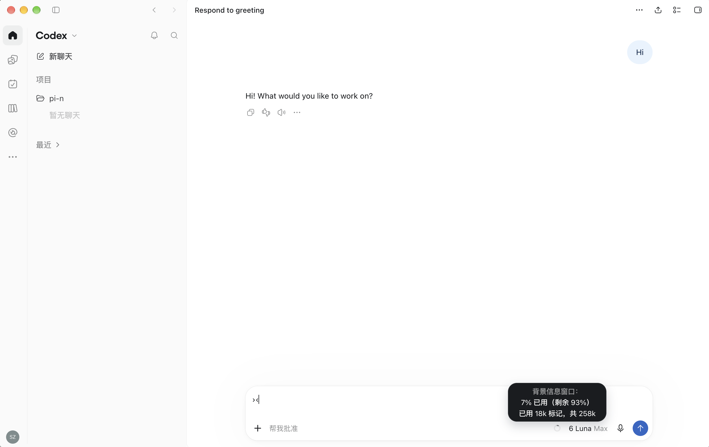
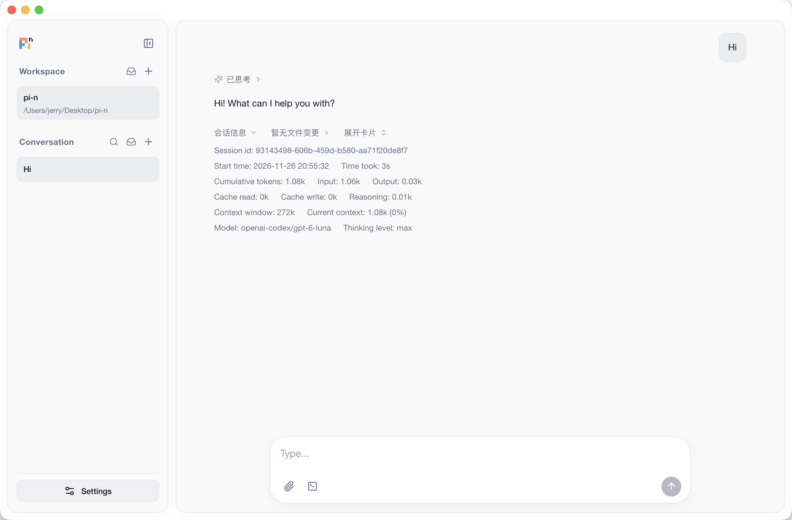
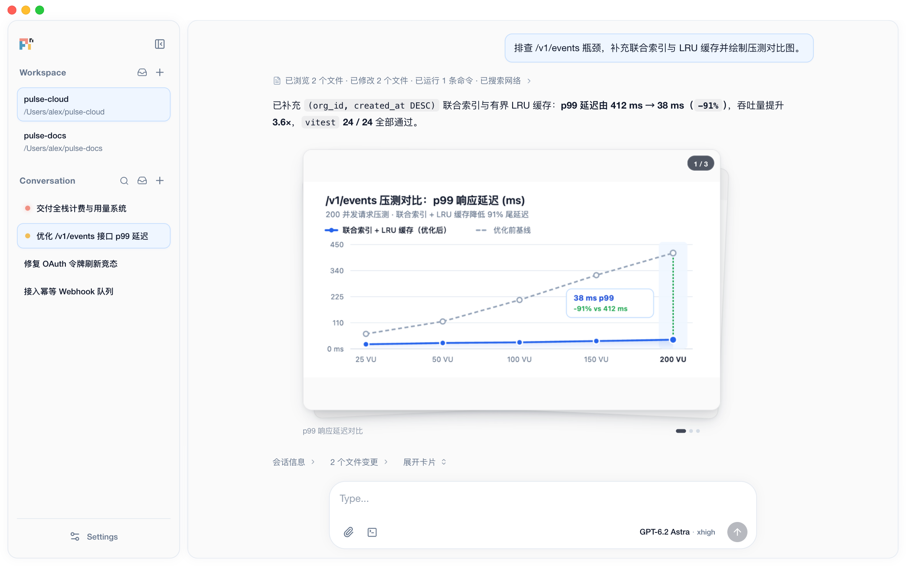
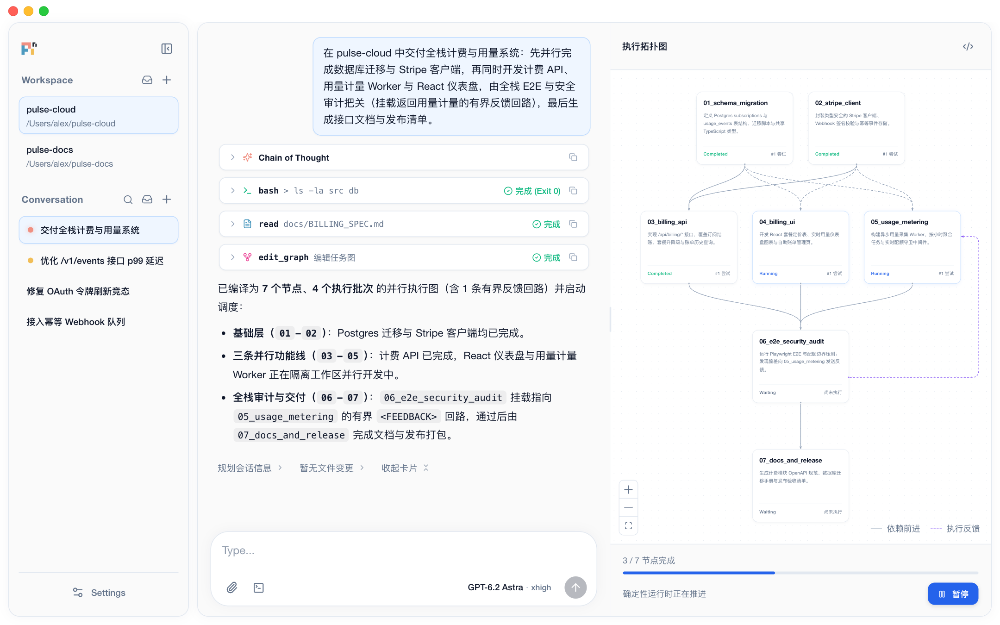

<p align="center">
  
</p>

<h1 align="center">Pi<sup>n</sup></h1>

<p align="center">
  <strong>Direct with one pi. Compile into many.</strong><br>
  基于 <a href="https://github.com/earendil-works/pi">Pi</a> 打造的本地优先桌面端 AI 编程 Agent Harness。<br>
  日常开发以极致顺手的单 Agent 高效开工，面对复杂多流工程时一键编译为确定性多 Agent 并行执行图。
</p>

<p align="center">
  <a href="https://github.com/zhexusun10/pi-n/releases/latest"></a>
  <a href="https://github.com/zhexusun10/pi-n/actions/workflows/planner-source.yml"></a>
  <a href="LICENSE"></a>
  <a href="https://www.rust-lang.org/"></a>
  <a href="https://github.com/earendil-works/pi"></a>
</p>

<p align="center">
  <a href="#快速开始"><strong>立即下载</strong></a> ·
  <a href="#为什么选择-pin">为什么选择 Pi<sup>n</sup></a> ·
  <a href="#工作台体验">工作台体验</a> ·
  <a href="#四款内置插件">四款内置插件</a> ·
  <a href="#compile-模式确定性多-agent-执行">Compile 模式</a> ·
  <a href="docs/user-guide.md">使用指南</a> ·
  <a href="README.md">English</a>
</p>

<p align="center">
  
  <br><sub>支持 macOS、Windows 原生桌面端（以及 Linux 浏览器发布包）。默认在 <strong>Direct</strong> 模式下使用增强版单 Pi Agent，或一键切换 <strong>Compile</strong> 驱动并行执行图。</sub>
</p>

---

## 为什么选择 Pi<sup>n</sup>

**我们非常喜欢 [Pi](https://github.com/earendil-works/pi)。** 相比市面上堆满系统提示词的编程 Harness，Pi 极度省 Token——不硬编码 few-shot，不引入先验偏置（prior bias），把最大的施展空间留给最强的模型，换来最好的通用性（generality）。在我们看来，Pi 是迄今为止最优雅、最出色的 Agent Harness Runtime。

在同一仓库、同一模型下只发送一句 `"Hi"`，差距就一目了然——**系统提示词占用相差约 16×（`1.08k` vs. `18k` tokens）**，在真实多轮开发任务中可带来 **2–4× 的端到端成本优势**：

<table>
  <thead>
    <tr>
      <th align="center">Codex — <code>18k tokens</code>（已占 7% 上下文）</th>
      <th align="center">Pi<sup>n</sup> + <code>pi-trim</code> — <code>1.08k tokens</code>（占 0% 上下文）</th>
    </tr>
  </thead>
  <tbody>
    <tr>
      <td width="50%"></td>
      <td width="50%"></td>
    </tr>
  </tbody>
</table>

**但 Pi 是一个极简运行时，而不是能直接开箱即用的产品。** Pi 仓库有着极其克制的边界——任何不属于最简 Agent Loop 的能力都不进入核心源码。这让 Pi 保持纯净，却也在真实工程中留下了四处高频痛点：

- **缺少开箱即用的 `web_search`** — 真实开发离不开查最新文档、RFC 与 API 变更，但裸 Pi 出厂不带联网搜索工具。
- **Loop 边界的鲁棒性隐患** — 对不爱写超时参数的模型，一条测试命令就可能直接卡死整轮运行；输出触及模型 output limit、流式断连或瞬时异常时会直接失败，无法自动断点续跑。
- **冗余的系统提示词噪音** — Pi 默认系统提示词里的 tool section 与各工具的 description 完全重复，附带的 Pi 自身文档对 99% 的工程任务毫无用处。
- **缺少开箱即用的工作台体验** — 内联 Diff、过程折叠阅读、停靠终端、多工作区管理与零配置安装包，都需要开发者自己拼装。

我们非常认同 Pi 守住极简内核的克制——**也正是这份边界，催生了 Pi<sup>n</sup> 的诞生。** Pi<sup>n</sup> 完整保留 Pi 纯粹无偏置的核心循环，将其打磨为真正开箱即用的工程产品：

- **四款精准插件，开箱补齐短板** — **`pi-trim`**、**`pi-continuity`**、**`pi-simple-timeout`** 与 **`pi-better-web-search`** 默认协同启用，逐一解决上述四类真实痛点，同时绝不向模型注入多余先验偏置。
- **30 秒零配置原生桌面端** — macOS / Windows 安装包（及 Linux 浏览器发布包）内置 Rust 后端、锁定版本 Pi `1.6.1`、私有 Node.js `22.19.0` 与按需便携 Git，同时 100% 兼容 Pi 的 OAuth / API Key、`models.json`、MCP、Skills 与外部扩展。
- **阅读时极度克制，审查时纤毫毕现** — 一键在“完整思维链 + 工具卡片 + 语法高亮内联 Diff”与“单行简约摘要”之间切换，配合停靠式原生终端、可翻阅图表堆叠与执行中随时打断引导。
- **按需无摩擦扩展至 `n` 个 Pi（`Compile` 模式）** — 当任务自然拆分为例如数据库、API、前端、Worker 与测试等独立工作流时，编译为**确定性（Deterministic）**的 Rust 执行图——**No more lost in translation**，**No Supervisor in the Execution Loop**，以真实 Git 工作区交接状态。

---

## 工作台体验

专为全天候工程开发打磨——**详尽过程审查** 与 **零干扰简约阅读** 在同一工作台自然共存，一键即可自由切换。

### 详尽审查与简约阅读，一键共存

<p align="center">
  
  <br><sub><strong>详尽视图 + 内联 Diff：</strong>随时查看 Chain of Thought、带退出码的工具卡片、自动 <strong>Compacted</strong> 上下文压缩卡片（<code>124.6k → 18.4k tokens</code> 含计费统计），以及右侧 <strong>文件变更</strong> 面板的语法高亮 Diff。</sub>
</p>

<p align="center">
  
  <br><sub><strong>简约视图（点击 <code>收起卡片</code> 一键切换）：</strong>多步推理与工具调用折叠为一行安静摘要，生成的压测对比图自动聚合成可翻阅卡片堆叠（<code>1 / 3</code>）；点击任意摘要行可局部展开，点击 <code>展开卡片</code> 随时切回。</sub>
</p>

- **结构化过程卡片与实时内联 Diff** — 随时展开 Chain of Thought、带状态与退出码的工具卡片、展示 Token 节省与计费明细的 **Compacted** 卡片，以及非报错的缓存/推理诊断提示；在 Direct 与 Compile 模式下均可呼出 **文件变更** 面板查看 `+/-` 统计、语法高亮内联 Diff 或直达本机编辑器。
- **零干扰阅读，不牺牲可观测性** — 点击 `收起卡片` 将连续的思维链、文件读写、命令执行与网络搜索归并为一行语义摘要（跨会话记忆），且每组步骤仍支持按需局部展开。
- **交互式图片堆叠与高清灯箱** — 当 Agent 输出 3 张及以上图表或截图时，自动收拢为支持滑动与键盘切换的卡片堆叠（`1 / 3`），支持点击高清原图预览及右键复制、保存、另存为或系统查看器打开。
- **为心流与多项目协作而生** — 支持为重要对话置顶并自定义品牌色圆点、拖拽排序工作区与对话、编辑历史消息创建分支；执行中按 **`Option+S` / `Alt+S`** 打断并立刻引导，按 **`Option+Q` / `Alt+Q`** 撤回排队指令，按 **`⌘G` / `Ctrl+G`** 跨对话检索。

### 停靠式原生终端与 Pi 斜杠指令（`/`）

<p align="center">
  
  <br><sub>底部停靠的原生 PTY 终端（<code>xterm.js</code>）搭配交互式 <code>/</code> 指令面板（输入 <code>/c</code> 实时筛选），上方保持清爽的收起卡片视图。</sub>
</p>

- **随时可用的停靠终端** — 从输入框一键打开当前项目目录（未绑定项目时默认主目录）的真实 Shell（`xterm.js` PTY），支持拖拽调高、最大化或最小化保活开发服务器与测试监听。
- **交互式斜杠指令（`/`）** — 对话中随时使用 `/model`、`/thinking` 切换模型与推理档位，`/scoped-models` 精简模型选择器，`/compact`、`/session`、`/copy`、`/name` 管理会话，以及 `/timeout`、`/pi-trim`、`/mcp` 与 `/skill:...`。
- **细腻的桌面端打磨** — 提供三种首页画布（**三色格子**、**点阵**、**动态线条**）、中英文双语界面、后台完成通知（含可选提示音）、登录自启与签名校验的应用内更新。

---

## 四款内置插件

四款扩展一一对应裸 Pi 在真实工程中的四处缺口——只做精准修补，不引入 few-shot 与提示词偏置——默认全部启用，均可在 **Settings → Pi 全局扩展** 中可视化管理：

<p align="center">
  
  <br><sub>四款内置插件开箱即启；从 <code>~/.pi/agent</code> 自动发现的外部扩展默认列于<strong>待选扩展</strong>安全按需启用，无需手改配置。</sub>
</p>

| 插件 | 默认状态 | 裸 Pi 的痛点 | Pi<sup>n</sup> 的解法 |
| --- | --- | --- | --- |
| **[`pi-trim`](https://github.com/zhexusun10/pi-trim)** | 始终启用 | 系统提示词中的 tool section 与工具 description 重复，附带的 Pi 文档对 99% 任务无用 | *"Less Pi in Pi."* 剥离冗余工具文本列表与 Pi 自身样板文档（将 Pi 1.5.0 默认系统文本削减 **70.4%**），完整保留工具 Schema、`<rules>` 与你的指令。 |
| **[`pi-continuity`](https://github.com/zhexusun10/pi-continuity)** | 默认启用 | 触及 output limit、流式中断或瞬时失败时直接报错，无法优雅断点续跑 | 通过 Pi 公共会话边界自动恢复输出截断、流式断连、冷却等待、额度轮询、空回复与工具调用尾挂，绝不注入伪造的 `"Continue"` 提示词。 |
| **[`pi-simple-timeout`](https://github.com/zhexusun10/pi-timeout)** | 默认启用 | 模型漏写超时参数时，测试或命令行可能无限挂起卡死整个任务 | 为内置 `bash` 工具配置默认 **180 秒**超时（支持 `/timeout` 实时调整），杜绝阻塞命令拖死运行。 |
| **[`pi-better-web-search`](https://github.com/zhexusun10/pi-better-web-search)** | 默认启用 | 出厂不带 `web_search`，无法检索最新文档、规范与报错信息 | 统一的 `web_search` 与网页抓取工具，支持 **Parallel、Keenable、Exa、Perplexity、DeepSeek** 跨源回退；默认启用 **Keenable 免费公共端点**，配置私有 API Key 后自动切换。 |

> **完整兼容 Pi 生态：** 自动发现 `~/.pi/agent` 外部扩展（Settings 中按需启用），支持 Pi 内置 **MCP** 客户端（在 `mcp.json` 或 `.pi/mcp.json` 配置后通过 `/mcp` 管理），加载工作区与全局 **Skills**（`/skill:...`），并与 `~/.pi/agent/models.json` 保持同步。

---

## Compile 模式：确定性多 Agent 执行

> **No more lost in translation. No Supervisor in the Execution Loop. Deterministic.**  
> 告别转述失真 · 执行循环零“主管” · 全链路确定性调度

绝大多数多智能体框架把协作困在脆弱的对话循环里：由“主管 LLM”居中总结需求、派发任务并转述回复。每一轮传话都在消耗 Token、丢失技术约束，并把编排变成不可控的概率猜测。

**Pi<sup>n</sup> 将工作流从对话中彻底“编译”出来。** 当一个功能可以自然拆分为例如数据库迁移、后端接口、异步 Worker、前端界面与端到端测试等并行工作流时，把输入框切换至 **Compile** 模式即可。

<p align="center">
  
  <br><sub>全栈计费系统 7 节点、4 批次并行执行实景：基础层（<code>01–02</code>）已完成，并行功能线（<code>03–05</code>）同时推进，下游 E2E 与安全审计节点（<code>06</code>）挂载紫色有界<strong>执行反馈</strong>回路指向 <code>05_usage_metering</code>，最终由 <code>07</code> 完成文档与发布清单。</sub>
</p>

```text
编程目标
  │
  ├── Direct（默认）──→ 单 Pi Agent（+ 四款内置插件）──→ 用户项目
  │
  └── Compile（或 Auto）
          │
          ▼
       Planner ──→ 执行拓扑图 ──→ Rust 编译器 ──→ 批准（自动或手动）
                                                        │
                                                        ▼
                                                确定性 Rust 运行时
                                                   ├── Pi Agent A ──┐
                                                   ├── Pi Agent B ──┼──→ Git 工作区状态继承
                                                   └── Pi Agent C ──┘            │
                                                                                 ▼
                                                                           下游执行节点
                                                                                 │
                                                                                 ▼
                                                                         原子发布写回项目
                                                                                 │
                                                                                 ▼
                                                                      任务后 Planner 复盘（闭环）
```

1. **No More Lost in Translation（告别转述失真）** — 节点之间绝不靠脆弱的聊天摘要传话。下游任务直接继承父节点真实的 **Git 提交历史与完整工作区状态**（含 `.gitignore` 产物），在精确代码基线与干净上下文中启动。
2. **No Supervisor in the Execution Loop（执行循环零主管）** — Planner 编译出执行图后即彻底退出调度循环，没有居中传话、反复总结或消耗 Token 的“主管 LLM”。
3. **Deterministic（全链路确定性）** — 依赖解析、有界并发（2–40 并发）、自适应工作区隔离（≤3 节点共享源目录，更大波次自动启用 macOS Seatbelt / Linux `bubblewrap` 独立沙箱）、重试、失效重算与原子发布全部由确定性 Rust 状态机驱动。
4. **自主闭环与有界反馈** — **Auto Approve** 与 **任务后 Planner 复盘** 默认开启，交付后自动审查仓库并推进后续迭代；开启 **启用 Feedback** 可为测试/审查节点挂载带重试预算的返工回路。
5. **拒绝预定义“角色扮演”** — 每个节点都是全能力的通用 Pi Coding Agent，专业化完全源于任务目标与继承的代码状态。

### Direct 与 Compile 对比

| | Direct（默认） | Compile |
| --- | --- | --- |
| **最佳场景** | 日常编码、Bug 修复、强耦合线性改动 | 多条独立工作流并行（数据库 + API + 前端 + Worker + E2E） |
| **Coding Agent** | 单个增强版 Pi Agent（+ 四款内置插件） | 多节点执行图（DAG + 可选有界反馈） |
| **规划与审批** | 立即执行 | 编译执行图；默认开启自动批准与任务后 Planner 复盘 |
| **工作区策略** | 直接操作源项目 | 自适应：≤3 派发节点共享源目录；>3 节点启用独立隔离工作区 |
| **调度引擎** | 顺序执行 | Rust 依赖感知、有界并发调度（2–40 并发） |

> **提示：** 希望由模型自动路由？在 **Settings → UI设置** 中关闭 **隐藏 Auto 模式** 即可启用 Partitioner 自动选择 Direct 或 Compile；在 **Settings → Compile模式设置** 中开启 **启用 Feedback** 可解锁有界返工边。

---

## 快速开始

### 1. 原生桌面端安装包（推荐 — macOS 与 Windows）

从 **[GitHub Releases](https://github.com/zhexusun10/pi-n/releases/latest)** 下载对应平台安装包，并使用 `SHA256SUMS.txt` 校验 SHA-256：

- **macOS（Apple Silicon）：** `Pi-n_<version>_aarch64.dmg`
- **macOS（Intel）：** `Pi-n_<version>_x64.dmg`
- **Windows（x64）：** `Pi-n_<version>_x64-setup.exe` *（当前用户 NSIS 安装程序）*

无需单独安装 Node.js、npm、Rust 或 Git——桌面端已内置编译好的 Rust 后端、锁定 Pi 运行时、四款插件与私有 Node.js `22.19.0`，若本机缺少可用 Git 将在首次启动自动下载并校验便携版 Git。

<details>
<summary>数据目录、旧版无感迁移与签名应用内更新</summary>

- **数据存储：** 桌面端运行数据保存在系统应用数据目录（macOS 为 `~/Library/Application Support/io.github.zhexusun10.pi-n/data`，Windows 为 `%APPDATA%\io.github.zhexusun10.pi-n\data`），模型凭据共享 `~/.pi-n/pi-agent`。
- **无感迁移：** 首次启动若检测到旧版 `.pi-n` 目录（或 `PI_N_LEGACY_DATA_DIR`），会在独占锁保护下原子复制并完整保留原目录。
- **应用内更新：** 已签名发布版本可在 **Settings → 应用更新** 中完成签名校验并自动更新（macOS 原地替换并重启；Windows 交由已签名 NSIS 安装程序完成）。详见[桌面端能力矩阵](docs/development/desktop-releases.md#updater--install-capability-matrix)。

</details>

### 2. 免编译 CLI / 浏览器发布包（macOS、Linux 与 Windows）

从 [GitHub Releases](https://github.com/zhexusun10/pi-n/releases/latest) 下载 `pi-n-*.tar.gz` 或 `pi-n-windows-x64.zip`，校验 `SHA256SUMS.txt` 并解压后运行 `./start.sh`（macOS / Linux）或 `start.bat`（Windows）。*（需在 `PATH` 中具备 Node.js 22.19+ 与 Git。）*

### 3. 从源码运行或构建桌面端

```sh
git clone --recurse-submodules https://github.com/zhexusun10/pi-n.git
cd pi-n
npm run dev
```

`npm run dev` 会自动校验工具链、初始化 `pi/` 子模块、安装锁定依赖并编译 Rust 后端*（已有克隆仓库请先执行 `git submodule update --init --recursive`）*。

- **浏览器工作台：** 开发模式访问 <http://127.0.0.1:1420>；生产构建运行 `npm run build && npm start` 并访问 <http://127.0.0.1:1421>。
- **桌面端开发模式（Tauri v2）：** `npm run desktop:dev`
- **构建桌面端安装包：** `npm run desktop:build` *（支持在对应系统指定 `--target macos-arm64`、`macos-x64` 或 `windows-x64`）*。

### 60 秒开启第一个任务

1. **绑定项目与服务商** — 打开 **Settings** 选择项目目录，完成服务商认证（OAuth 浏览器/设备码登录、API Key 或 `npm run pi`）并选择默认 `provider/model`。
2. **在 Direct 模式开工** — 四款内置插件立即就绪；随时一键切换详尽与简约视图，呼出 **文件变更** 审查内联 Diff，或打开底部停靠终端。
3. **按需切换 Compile 并行加速** — 遇到多流工程时切换 **Compile** 模式，执行中随时按 **`Option+S` / `Alt+S`** 打断并实时引导，完成后直接在项目目录验收提交。

<details>
<summary>系统依赖与平台隔离说明</summary>

- **桌面端安装包：** 仅需网络与模型服务商认证。
- **发布包与源码构建：** 需 Node.js 22.19+、Git 与 npm；源码构建另需稳定版 Rust 及本机编译工具（macOS 需 Xcode Command Line Tools；Windows 需 MSVC Build Tools）。
- **体积与隔离策略：** Direct 模式与未开启隔离的 Compile 运行不限制工作区体积；开启「并行节点独立工作区」的 Compile 任务设有 15 GB 保护上限（可通过选择子目录或在设置中关闭隔离调整）。macOS 使用 Seatbelt 沙箱并在后端运行时保持唤醒（`PI_N_KEEP_AWAKE=0` 可关闭）；Linux 需 `bubblewrap` 与非特权 namespace；Windows 工作区不是文件系统沙箱。

</details>

---

## 文档与资源

| 文档 | 内容概览 |
| --- | --- |
| **[使用指南（User Guide）](docs/user-guide.md)** | 日常操作流程、斜杠指令、节点干预、工作区隔离与异常恢复 |
| **[桌面端发布与密钥指南](docs/development/desktop-releases.md)** | Tauri v2 构建、安装包、更新签名密钥、macOS 公证与发布 CI |
| **[架构契约（Architecture Contracts）](docs/architecture/overview.md)** | 系统组件边界、编译器规则、Rust 运行时与 Git 工作区交接 |
| **[基准评测（Benchmarks）](docs/benchmarks/harbor.md)** | Harbor 评测框架接入与基准测试方法 |
| **[贡献指南](CONTRIBUTING.md)** 与 **[测试指南](docs/development/testing.md)** | 开发环境搭建、模块归属边界与按需验证测试套件 |
| **[文档索引](docs/index.md)** 与 **[安全政策](SECURITY.md)** | 完整文档路由、Agent 仓库约束（[AGENTS.md](AGENTS.md)）与漏洞报告 |

## 许可证

Pi<sup>n</sup> 原创代码采用 [MIT 许可证](LICENSE)，版权所有 © 2026 Sun Zhe-xu。上游 `pi/` 子模块遵循其自身的 [MIT 许可证](pi/LICENSE)；内置插件与第三方依赖遵循各自的许可证。
