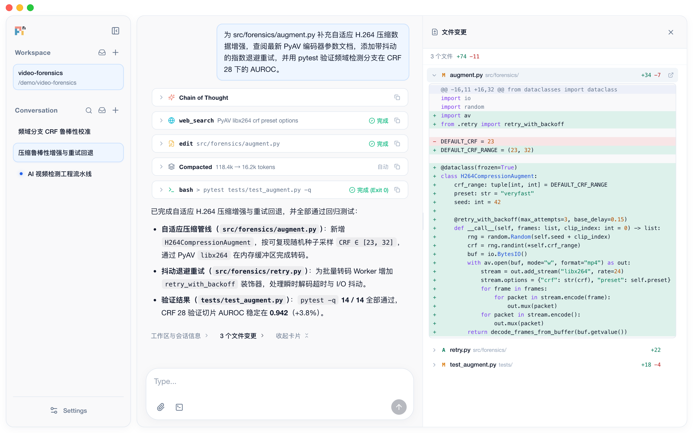
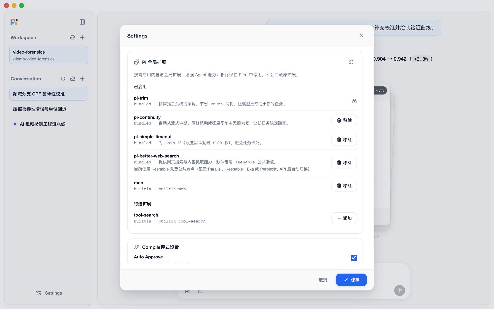

<p align="center">
  
</p>

<h1 align="center">Pi<sup>n</sup></h1>

<p align="center">
  <strong>Direct with one pi. Compile into many.</strong><br>
  开箱即用、全面进化的 <a href="https://github.com/earendil-works/pi">Pi</a> Coding Agent 工作台——将克制的收起卡片简约模式、内联 Diff、停靠式终端与四款默认启用的精选插件融为一体，打磨极致的单 Agent 日常体验；当任务需要并行扩展时，一键切换由确定性 Rust 运行时驱动的编译式多 Agent 执行图。
</p>

<p align="center">
  <sub>面向 macOS、Windows 与 Linux 的本地优先桌面端与浏览器工作台</sub>
</p>

<p align="center">
  <a href="#工作台与-ui-模式">工作台与 UI</a> ·
  <a href="#四款内置插件开箱即启">四款内置插件</a> ·
  <a href="#compile-模式确定性多-agent-并行执行">Compile 模式</a> ·
  <a href="#快速开始">快速开始</a> ·
  <a href="docs/user-guide.md">使用指南</a> ·
  <a href="README.md">English</a>
</p>

<p align="center">
  <a href="https://github.com/zhexusun10/pi-n/actions/workflows/planner-source.yml"></a>
  <a href="LICENSE"></a>
  <a href="https://www.rust-lang.org/"></a>
  <a href="https://github.com/earendil-works/pi"></a>
</p>

<p align="center">
  
  <br><sub>Pi^n 工作台：默认在 <strong>Direct</strong> 模式下使用全面增强的单 Pi Agent 高效编码；面对复杂多流工程时，一键切换 <strong>Compile</strong> 编译并驱动并行执行图。</sub>
</p>

---

## 为什么选择 Pi<sup>n</sup>

多数 AI 编程工具都在迫使开发者二选一：要么停留在简陋的终端 CLI 里自己折腾插件、鉴权、Diff 审查和断线恢复；要么引入厚重的多 Agent 框架，连简单的日常改动也被冗余编排拖慢。

**Pi<sup>n</sup> 先把单 Agent 的 Pi 做到开箱即强、极其顺手，再在真正需要并行时无摩擦扩展至 `n` 个 Agent：**

- **开箱即用的增强版 Pi（`Direct` 模式）** — 单个原生桌面端安装包（或免编译发布包）即内置锁定版本 Pi 运行时、Rust 后端、Node.js `22.19.0` 与按需便携 Git。完整兼容 Pi 生态（多服务商 OAuth / API Key 鉴权、`~/.pi/agent/models.json`、斜杠指令、MCP、Skills 与全局扩展），并包裹在清晰专注的可视化工作台中。
- **四款精选插件，默认全部启用** — 原生打包并协同调优，各司其职解决 Coding Agent 的四大真实痛点：系统提示词冗余（**`pi-trim`**）、流式中断与输出截断（**`pi-continuity`**）、Shell 命令卡死（**`pi-simple-timeout`**）与实时联网检索（**`pi-better-web-search`**）。
- **编译式多 Agent 执行（`Compile` 模式）** — 当需求自然拆分为多个独立模块或流水线时，Pi<sup>n</sup> 将目标编译为可检查的执行拓扑图，由确定性 Rust 状态机调度并通过 Git 状态无缝继承，彻底终结“多 Agent 传话筒”内耗。

---

## 工作台与 UI 模式

Pi<sup>n</sup> 专为全天候工程开发打磨——想要专注时极度克制，需要排错时每一处细节触手可及。

### 1. 收起卡片的简约模式与内联图表堆叠

点击输入框上方的 **`收起卡片`**，即可将冗长的思维链、连续工具调用与中间步骤折叠为单行活动摘要——偏好在所有对话间全局生效：

<p align="center">
  
  <br><sub>收起卡片简约模式（已启用 <code>收起卡片</code>）：多步推理与工具调用折叠为一行摘要（<code>已浏览 2 个文件 · 已修改 2 个文件 · 已运行 1 条命令 · 已搜索网络</code>），多张评估图表自动聚合为可翻阅卡片堆叠；点击摘要行可按需展开细节，点击 <code>展开卡片</code> 随时切回完整视图。</sub>
</p>

- **极简无噪阅读流** — 连续的思维链、文件读写、命令执行与网络搜索自动归并为一行语义化摘要（`ActivitySummaryRow`），让对话焦点留在结论与代码本身；点击任意摘要行即可局部展开排错，无需退出简约模式。
- **交互式图片堆叠（`MarkdownImageStack`）** — 当 Agent 输出 3 张及以上工作区图表、截图或网页图片时，自动收拢为支持滑动、键盘切换与点击大图预览的卡片堆叠（`1 / 3`），告别长图刷屏。

### 2. 完整卡片展开与实时内联 Diff 审查

随时切回完整卡片视图（`展开卡片` / `收起卡片`），并呼出右侧 **文件变更** 面板进行实时代码审查：

<p align="center">
  
  <br><sub>完整卡片 + 内联 Diff：展开查看 <strong>Chain of Thought</strong>、带退出码的工具卡片、自动 <strong>Compacted</strong> 上下文压缩卡片（<code>118.4k → 16.2k tokens</code>），搭配右侧 <strong>文件变更</strong> 面板的语法高亮内联 Diff。</sub>
</p>

- **结构化对话卡片** — 支持按需折叠/展开 **Chain of Thought（思维链）**、带状态与退出码的 **工具调用卡片**，以及直观展示 Token 压缩量与保留关联文件的 **Compacted 上下文压缩卡片**。
- **实时内联 Diff 面板** — 在 Direct 与 Compile 模式下均可打开 **文件变更** 面板，查看各文件 `+/-` 变更统计，点击条目直接展开语法高亮 Diff，或点击图标用本机默认编辑器打开文件。
- **随时介入与快捷检索** — 支持编辑历史消息创建分支；聚焦输入框时按 **`Alt+S`** 打断当前工具执行并立刻引导，按 **`Alt+Q`** 将未消费的排队指令撤回输入框，按 **`⌘G` / `Ctrl+G`** 快速检索当前工作区对话。

### 3. 停靠式工作区终端与 Pi 斜杠指令（`/`）

保留终端 CLI 的极客效率，同时享受原生桌面工作台的顺滑交互：

<p align="center">
  
  <br><sub>底部停靠的原生 PTY 终端（<code>xterm.js</code>）搭配交互式 <code>/</code> 指令面板（图中输入 <code>/c</code> 筛选出 <code>/copy</code>、<code>/compact</code>、<code>/mcp</code>、<code>/scoped-models</code>），上方对话流保持收起卡片的清爽视觉。</sub>
</p>

- **停靠式原生终端** — 点击附件旁的终端按钮即可在当前项目目录打开真实 Shell（`xterm.js` PTY），支持拖拽调高、全屏最大化，或最小化保活后台开发服务器与测试监听。
- **完整斜杠指令（`/`）** — 对话中随时使用 `/model`、`/thinking` 切换模型与推理档位，`/scoped-models` 全局隐藏冗余模型，`/compact`、`/session`、`/copy`、`/name` 管理会话，以及 `/timeout`、`/pi-trim`、`/mcp` 与 `/skill:...` 调起插件与技能弹窗。
- **细腻的桌面端打磨** — 支持切换首页视觉风格（默认 **三色格子**、**点阵**、**动态线条**）、中英文双语切换、后台任务完成系统通知（含可选提示音）、登录时自动启动，以及经过签名校验的应用内自动更新。

---

## 四款内置插件，开箱即启

Pi<sup>n</sup> 原生内置四款面向真实工程打磨的 Pi 扩展——默认全部启用，均可在 **Settings → Pi 全局扩展** 中可视化管理：

<p align="center">
  
  <br><sub>四款内置插件与原生 <code>mcp</code> 开箱即启，并自动发现全局 <code>~/.pi/agent</code> 扩展，全程可视化开关，无需手改配置文件。</sub>
</p>

| 插件 | 默认状态 | 职责定位 | 解决的核心问题 |
| --- | --- | --- | --- |
| **[`pi-trim`](https://github.com/zhexusun10/pi-trim)** | 始终启用 | **提示词精简** | *"Less Pi in Pi."* 在 Pi<sup>n</sup> 中默认以激进模式运行——自动剥离 Pi 自身身份样板、`<docs>` 文档索引、`PI_*` 环境变量提示及与 API 工具定义重复的 `<tools>` 文本列表，将 Pi 1.5.0 默认系统文本削减 **70.4%**，同时完整保留工具 Schema、`<rules>` 与你的指令。 |
| **[`pi-continuity`](https://github.com/zhexusun10/pi-continuity)** | 默认启用 | **长任务韧性恢复** | 通过 Pi 公共会话边界（`context_edit` + `continue: true`）自动恢复输出长度截断（`stopReason: "length"`）、流式断连、显式冷却等待、订阅额度周期轮询、空回复/纯思考回复与工具调用尾挂，全程不注入伪造的 `"Continue"` 提示词。 |
| **[`pi-simple-timeout`](https://github.com/zhexusun10/pi-timeout)** | 默认启用 | **Shell 超时兜底** | 为内置 `bash` 工具注入可配置的默认超时（默认 **180 秒**，随时通过 `/timeout` 实时调整并刷新工具 Schema），避免阻塞命令卡死整个任务。 |
| **[`pi-better-web-search`](https://github.com/zhexusun10/pi-better-web-search)** | 默认启用 | **互联网级工作记忆** | 提供单一高质量 `web_search` 工具，原生支持 **Parallel、Keenable、Exa、Perplexity、DeepSeek** 搜索 API、网页抓取、原始结果直出及跨服务商自动回退；默认启用 **Keenable 免费公共端点**，一旦配置 Parallel、Keenable、Exa 或 Perplexity 私有 API Key 即自动切换。 |

> **完整兼容 Pi 生态：** Pi<sup>n</sup> 同时自动发现 `~/.pi/agent` 中的全局扩展、原生集成 **MCP**（`/mcp`）、加载工作区与全局 **Skills**（`/skill:...`），并与本地 `~/.pi/agent/models.json` 保持同步。

---

## Compile 模式：确定性多 Agent 并行执行

当工程目标包含多条独立模块、多模态分支或并行开发与验证流水线时，将输入框切换为 **Compile** 模式。

绝大多数多智能体框架都把工作困在脆弱的对话循环里：由一个“主管 LLM”居中传话——总结需求、派发任务、解读回复、再决定下一步。每经过一轮转述，技术约束层层衰减，不仅消耗 Token，更引发严重的**多 Agent 传话筒失真（Lost in Translation）**。

**Pi<sup>n</sup> 将工作流从对话中彻底“编译”出来。**

<p align="center">
  
  <br><sub>Compile 模式运行实景：7 个节点、4 个执行批次的并行执行图——基础节点（<code>01–02</code>、<code>03</code>）已完成，时序与频域分支（<code>04–05</code>）正在并行执行，验证压测节点（<code>06</code>）挂载有界 <strong>执行反馈</strong> 回路，由确定性 Rust 运行时推进。</sub>
</p>

```text
编程目标
  │
  ├── Direct（默认）──→ 单 Pi Agent（+ 四款内置插件）──→ 用户项目
  │
  └── Compile（或 Auto）
          │
          ▼
       Planner ──→ 执行拓扑图 ──→ Rust 编译器 ──→ 批准（自动或手动）
                                                        │
                                                        ▼
                                                确定性 Rust 运行时
                                                   ├── Pi Agent A ──┐
                                                   ├── Pi Agent B ──┼──→ Git 工作区状态继承
                                                   └── Pi Agent C ──┘            │
                                                                                 ▼
                                                                           下游执行节点
                                                                                 │
                                                                                 ▼
                                                                           发布写回项目
                                                                                 │
                                                                                 ▼
                                                                      任务后 Planner 复盘（闭环）
```

1. **传递代码，而非闲聊（零转述失真）** — 节点之间**绝不交换聊天消息**。下游任务直接继承父节点真实的 **Git 提交历史与完整项目状态**（含 `.gitignore` 文件），每个 Agent 都在干净上下文窗口与确定性代码基线上启动。
2. **执行循环中没有“主管”** — Planner 编译执行图后即退出调度器。依赖解析、有界并发（2–40 个 Agent）、重试、失效重算与写回发布全部由确定性的 Rust 状态机严格驱动。
3. **自适应工作区隔离与原子发布** — 空闲边界下，小规模派发（≤3 个节点）直接共享源目录保持极速；开启隔离时，更大规模并行波次自动分配独立工作区（macOS Seatbelt / Linux `bubblewrap`），整批通过后原子写回项目。
4. **自主闭环迭代与有界反馈** — 默认开启 **Auto Approve** 与 **任务后 Planner 复盘**：交付代码后 Planner 自动审查最新仓库并推进后续迭代或收尾验证；开启 **启用 Feedback** 可为审查/测试节点挂载带重试预算的自动返工回路。
5. **拒绝预定义“角色扮演”** — 没有僵硬的“产品经理 / 架构师 / 测试员”人设。每个节点都是全能力的通用 Pi Coding Agent，专业化完全源自任务目标与继承的代码状态。

### Direct 与 Compile 一览

| | Direct（默认） | Compile |
| --- | --- | --- |
| **最佳场景** | 日常编码、线性或高度耦合的改动 | 多条独立工作流并行（前后端、实现+测试、ML 多分支等） |
| **Coding Agent** | 单个增强版 Pi Agent（+ 四款内置插件） | 多节点执行图（DAG + 可选有界反馈） |
| **规划与审批** | 直接执行 | 编译执行图；默认开启自动批准与任务后 Planner 复盘 |
| **工作区策略** | 直接操作源项目 | 空闲边界自适应：≤3 派发节点共享源目录；>3 节点启用独立隔离工作区 |
| **调度引擎** | 顺序执行 | Rust 依赖感知、有界并发调度（2–40 并发） |

> **提示：** 希望由模型自动路由？在 **Settings → UI设置** 中关闭 **隐藏 Auto 模式** 即可启用 Partitioner 自动选择 **Direct** 或 **Compile**；在 **Settings → Compile模式设置** 中开启 **启用 Feedback** 即可解锁有界返工边。详见[使用指南](docs/user-guide.md)。

---

## 快速开始

### 方式一：下载原生桌面端安装包（推荐 — macOS 与 Windows）

从 [GitHub Releases](https://github.com/zhexusun10/pi-n/releases/latest) 下载对应平台的原生安装包，并使用 `SHA256SUMS.txt` 校验完整性：

- **macOS（Apple Silicon）：** `Pi-n_<version>_aarch64.dmg`（将 `Pi^n.app` 拖入「应用程序」）
- **macOS（Intel）：** `Pi-n_<version>_x64.dmg`（将 `Pi^n.app` 拖入「应用程序」）
- **Windows（x64）：** `Pi-n_<version>_x64-setup.exe`（当前用户 NSIS 安装程序）

桌面端已内置编译好的 Rust 后端、锁定的 Pi 运行时、四款内置插件与私有 Node.js `22.19.0`，无需单独安装 Node.js、npm、Rust 或手动配置 Git（若首次启动未检测到可用 Git，将自动下载并 SHA-256 校验便携版 Git）。

- **数据目录与无感迁移：** 桌面端数据保存在系统应用数据目录（macOS 为 `~/Library/Application Support/io.github.zhexusun10.pi-n/data`，Windows 为 `%APPDATA%\io.github.zhexusun10.pi-n\data`），模型凭据共享 `~/.pi-n/pi-agent`。首次启动若检测到旧版 `.pi-n` 数据（或通过 `PI_N_LEGACY_DATA_DIR` 指定），会在独占锁保护下原子复制并完整保留原目录。
- **应用内更新：** 已签名发布版本可在 **Settings → 应用更新** 中完成签名校验并自动更新（macOS 原地替换并重启；Windows 交由已签名 NSIS 安装程序完成更新与重启）。详见[桌面端能力矩阵](docs/development/desktop-releases.md#updater--install-capability-matrix)。

### 方式二：下载 CLI / 浏览器免编译发布包（macOS、Linux 与 Windows）

下载最新可重定位[发布包（Release Archive）](https://github.com/zhexusun10/pi-n/releases/latest)（`pi-n-*.tar.gz` 或 `pi-n-windows-x64.zip`），使用 `SHA256SUMS.txt` 校验后解压启动：

- **Windows：** 双击或运行 `start.bat`
- **macOS / Linux：** 运行 `./start.sh`

*（运行时需在 `PATH` 中具备 Node.js 22.19+ 与 Git。）*

### 方式三：从源码运行或构建桌面端

```sh
git clone --recurse-submodules https://github.com/zhexusun10/pi-n.git
cd pi-n
npm run dev
```

`npm run dev` 会自动检查环境工具、初始化锁定的 `pi/` 子模块、安装锁定依赖（含四款内置插件）并编译 Rust 后端（如需分步执行，可运行 `npm ci --ignore-scripts` 与 `npm run pi:setup`）。已有克隆仓库请先执行 `git submodule update --init --recursive`。

- **浏览器模式：** `npm run dev` 启动后访问 **<http://127.0.0.1:1420>**；本机生产模式可运行 `npm run build && npm start` 并访问 <http://127.0.0.1:1421>。
- **桌面端开发模式（Tauri v2）：** 运行 `npm run desktop:dev`。
- **构建桌面端安装包：** 运行 `npm run desktop:build`（支持按平台指定 `--target macos-arm64`、`macos-x64` 或 `windows-x64`）。签名与公证配置见[桌面端发布与密钥指南](docs/development/desktop-releases.md)。

### 三步开启第一个任务

1. **绑定项目与模型** — 打开 **Settings** 选择本地项目目录，完成服务商认证（支持 OAuth 浏览器/设备码登录、API Key 或 `npm run pi`）并选择默认 `provider/model`。
2. **在 Direct 模式高效开工** — 四款内置插件（含 `pi-better-web-search`）默认全部就绪；随时点击 **收起卡片** 进入简约视图，呼出 **文件变更** 审查内联 Diff，或打开底部停靠终端。
3. **按需切换 Compile 并行加速** — 遇到多模块工程时切换 **Compile** 模式编译执行图，执行期间随时按 **`Alt+S`** 打断并实时引导，完成后直接在工作区验收结果。

**环境依赖与平台说明：**
- **桌面端安装包：** 网络与模型服务商认证即可（Node.js `22.19.0`、锁定 Pi 运行时与四款插件均已内置；缺失 Git 时首次启动自动下载）。
- **发布包与源码构建：** Node.js 22.19+、Git、npm；源码构建另需稳定版 Rust 与本机编译链接工具（macOS 需 Xcode Command Line Tools；Windows 需 MSVC Build Tools）。
- **隔离与唤醒：** macOS 使用内置 Seatbelt 沙箱执行 Compile 独立工作区，且后端运行时默认保持系统唤醒（`PI_N_KEEP_AWAKE=0` 可关闭）；Linux 独立工作区需安装 `bubblewrap` 并开启非特权 user/mount/PID namespace；Windows 工作区不是文件系统沙箱。

---

## 文档与资源

| 文档 | 内容概览 |
| --- | --- |
| **[使用指南（User Guide）](docs/user-guide.md)** | 日常操作流程、斜杠指令、节点干预、工作区隔离、数据迁移与异常恢复 |
| **[桌面端发布与密钥指南](docs/development/desktop-releases.md)** | Tauri v2 桌面端构建、安装包、更新签名密钥、macOS 签名公证与 CI 发布流水线 |
| **[架构契约（Architecture Contracts）](docs/architecture/overview.md)** | 系统组件边界、编译器规则、确定性 Rust Runtime 与 Git 工作区交接机制 |
| **[基准评测（Benchmarks）](docs/benchmarks/harbor.md)** | Harbor 评测框架接入与基准测试方法 |
| **[贡献指南](CONTRIBUTING.md)** 与 **[测试指南](docs/development/testing.md)** | 开发环境搭建、模块归属边界与按需验证测试套件 |
| **[文档索引](docs/index.md)** 与 **[安全政策](SECURITY.md)** | 完整文档路由、Coding Agent 仓库约束（[AGENTS.md](AGENTS.md)）与漏洞报告方式 |

## 许可证

Pi<sup>n</sup> 原创代码采用 [MIT 许可证](LICENSE)，版权所有 © 2026 Sun Zhe-xu。上游 `pi/` 子模块遵循其自身的 [MIT 许可证和版权声明](pi/LICENSE)；内置插件与第三方依赖遵循各自的许可证。
